# Geo-Ref-skills

地図の画像が、地上のどこを描いたものかを求める作業 (ジオリファレンス) を、コーディング AI エージェントが間違えずに進めるためのスキルとハーネスです。

歪んだ地図の画像と、だいたいの場所を渡すと、画像の点と地上の経緯度の対応 (GCP、地上基準点) と、画像全体を地上に写す変換を返します。


地図: [© OpenStreetMap contributors](https://www.openstreetmap.org/copyright)

## 考え方

- LLM や VLM に座標を推測させない。画像の照合、変換の推定、外れた点の除去、誤差の評価は、Python の決定論的な処理と古典的な機械学習の道具として、エージェントに渡します。
- 答えを返す前に、機械で確かめる関門を通します。点の数と広がり、変換の残差と形、縁での誤差の大きさ、手がかりの範囲との整合を確かめ、通らなければ止まります。
- 解けないときは、もっともらしい答えを作らず、理由を付けて「解けない」と宣言します。失敗を既定値や推測で埋めません。
- 道具と関門は、正解が分かる模擬の課題で採点してから使います。失敗した課題は記録し、崩れた前提を確かめて、スキルを直します ([AGENTS.md](AGENTS.md))。

## 模擬の課題とレベル

自前のタイルサーバー (tile.yuiseki.net) の地図に、正解の分かる歪み (回転、縮尺、せん断、透視など) を掛けて課題を作ります。易しい順にレベル 1〜5 に分け、下から順に解けるようにしています。その先のマイルストーンとして、地図の中身を地理空間情報に戻すレベル 6 を置いています ([docs/curriculum.md](docs/curriculum.md))。

| レベル | どんな地図か | 今の状況 (2026-11-04) |
|---|---|---|
| 1 | 参照と同じ描き方の地図 | できた |
| 2a | 同じ描き方を、灰色や白黒にした地図 | ほぼできた |
| 2 | 配色も線の太さも違う描き方の地図 | 半分ほど |
| 3 | 文字やアイコンを消した地図、水も文字も無い地図、川だけや鉄道だけの地図 | 文字の無い地図はできた、水も文字も無い地図は半分ほど、線だけの地図は始めたところ |
| 4 | 場所の分からない、ただの地図の画像 | 始めたところ |
| 5 | PDF や文書の中に入っている地図 | 未着手 |
| 6 | 位置を合わせた地図の中身 (凡例の範囲など) を、GeoJSON に戻す | マイルストーン (未着手) |

レベル 1〜3 では、手がかりとして、余白付きの経緯度の枠とズームを渡します。手がかり無しで場所を探させると、探索が終わらなくなるおそれがあるためです。

どのレベルでも、関門を通ったのに場所が間違っている答えは、これまで 0 件です。わざと別の場所の手がかりを渡した対照の課題 (46 件) も、全て拒否しました。

### 図の見方

以下の例は全て、道具だけで解いたものです (エージェントの判断は入っていません)。

- 左 (入力): 道具に渡した歪んだ地図。赤い丸は、道具が見つけた GCP。
- 右 (結果): 答えの変換で地上に戻した地図の道路、線、文字を赤紫で描き、淡く表示した参照の地図に重ねたもの。位置が合っていれば、赤紫は下の道路や文字にぴったり乗り、ずれていれば横に並んで二重に見えます。赤い枠は、入力の画像の範囲を地上に写したもの。
- 誤差は、正解の変換と比べた値です。

## レベル 1: 同じ描き方の地図

参照と同じスタイル (osm-liberty) の地図を歪ませた課題です。局所の特徴 (SIFT) を照合して GCP を作ります。

### 東京の都心 (透視の歪み)

| 入力 | 結果 |
|---|---|
|  |  |

地図: [© OpenStreetMap contributors](https://www.openstreetmap.org/copyright)

GCP 268 点、関門は全て通過。誤差は最大 1.63 m、中央値 0.43 m です (画像の範囲は地上で約 5.4 km x 3.2 km)。

### 十勝の畑 (地物がまばらで、強いアフィンの歪み)

| 入力 | 結果 |
|---|---|
|  |  |

地図: [© OpenStreetMap contributors](https://www.openstreetmap.org/copyright)

GCP 36 点、誤差は最大 2.66 m、中央値 0.76 m です (範囲は約 4.9 km x 2.7 km)。

最初は普通の SIFT では対応が足りず、失敗を宣言していた例です。崩れた前提 (SIFT は縦横比やせん断の変化に弱い) を確かめ、斜めから見た見え方を模して特徴を取る ASIFT をスキルに足してから解けるようになりました。

開発中に結果を見て直した 54 課題は全て正解し、その後、見ていない場所、種、ズーム (z13 と z17) の 32 課題でも全て正解しました。

## レベル 2a: 灰色や白黒にした地図

白黒のコピーを模して、同じスタイルを灰色や二値にした地図を、色付きの参照に合わせます。色が無くなっても道路や建物の形は残るので、色に頼らずに照合します。

| 入力 | 結果 |
|---|---|
|  |  |

地図: [© OpenStreetMap contributors](https://www.openstreetmap.org/copyright)

大阪、GCP 163 点、誤差は最大 0.94 m です。72 課題のうち 64 課題を正解しました。解けなかったのは、二値にすると畑の区画がほとんど消える地図で、道具は失敗を宣言しています。

## レベル 2: 違う描き方の地図

配色、線の太さ、文字の位置が違うスタイルの地図を、osm-liberty の参照に合わせます。描き方が変わると局所の特徴が合わなくなるので、描き方が変わっても残るものを使います。

- 水は、ほとんどのスタイルで青く描かれる。水の青で粗く位置を合わせる。
- 色の対応が分からなくても、「この地図のこの色の所は、あの地図ではあの色」という関係は場所ごとに保たれる。小さな升ごとに、この関係 (相互情報量) が最も強くなる位置を探して合わせ込む。
- 升ごとの答えが 1 つの変換にそろうかどうかで、場所が正しいかを判定する。別の場所なら、升ごとの答えはばらばらになる。

### osm-carto の地図

| 入力 | 結果 |
|---|---|
|  |  |

地図: [© OpenStreetMap contributors](https://www.openstreetmap.org/copyright)

大阪、GCP 75 点、誤差は最大 2.16 m です。

レベル 2 全体では 48 課題のうち 28 課題を正解しました。解けなかった 20 課題のうち 10 課題は、水の少ない旭川の郊外の地図です。

## レベル 3: 要素を絞った地図

参照より描かれているものが少ない地図です。3 種類を試しています。

### 文字とアイコンを消した地図

現実に多いのは、地名や記号の無い地図です。osm-liberty から文字とアイコンを消したスタイル (osm-liberty-no-text-no-icons) の地図を、文字のある普通の osm-liberty に合わせます。道路や水の形は残るので、局所の特徴の照合 (レベル 1 と同じ道具) で解けました。

| 入力 | 結果 |
|---|---|
|  |  |

地図: [© OpenStreetMap contributors](https://www.openstreetmap.org/copyright)

新潟、GCP 27 点、誤差は最大 1.68 m です。開発中に使っていない広島、新潟、松本の 24 課題を全て正解し (誤差は最大 3.64 m)、別の場所の手がかりを渡した対照 6 件も全て拒否しました。

### 水も文字も無い地図 (e-paper、透視の歪み)

| 入力 | 結果 |
|---|---|
|  |  |

地図: [© OpenStreetMap contributors](https://www.openstreetmap.org/copyright)

黒、白、赤、黄の 4 色で描く、開発中に見ていないスタイル (e-paper-ez-sign) です。水を背景と同じ白で描き、文字もほぼ無く、残っているのは道路、鉄道、公園だけです。福岡、GCP 80 点、誤差は最大 1.83 m です。

レベル 2 の道具 (水の青で粗く合わせる方法) は「画像に水が無い」と失敗を宣言します。そのときだけ、次の手として、道路だけのスタイル (roads-minimal) を参照にして、道路の中心線どうしで合わせます。福岡と仙台の 16 課題のうち 9 課題を正解しました。

最初はスタイル名だけを見てレベル 2 に入れていましたが、描かれている中身 (水も文字も無い) と解き方から、レベル 3 に移しました (2026-11-04)。

### 川だけ、鉄道だけの地図

文字も色の手がかりも無く、線の形だけで合わせます。線の太さの違いを消すため、線を中心線に細めてから照合します。

| 入力 | 結果 |
|---|---|
|  |  |

地図: [© OpenStreetMap contributors](https://www.openstreetmap.org/copyright)

大阪の鉄道、GCP 55 点、誤差は最大 2.48 m です。

### 解けないと宣言して止まった例


地図: [© OpenStreetMap contributors](https://www.openstreetmap.org/copyright)

金沢の鉄道の地図です。線が 2 本ほどしか無く、場所を決める手がかりが足りません。升ごとの照合で 1 つの変換にそろった升は 4 個で、下限の 12 に届かなかったため、道具は答えを出さずに止まりました。ここでは、これが正しい振る舞いです。

川だけ、鉄道だけの地図は、48 課題のうち 6 課題の正解にとどまっています。線が画像の 1% 未満の課題は、どの道具でも位置が決まりません。また、正しい答えなのに関門が拒否する課題が 10 件あり、原因はまだ分かっていません。

## レベル 4: 場所の分からない地図

手がかりの枠を渡さず、「これは地図です」とだけ言って画像を渡す課題です。場所を探すこと自体が課題になります。

地図の地名を読み (tesseract)、自前の Nominatim で引いて場所のあたりを付けます (`place-hint`)。さらに、名前が画像のどこに書かれているかと、地上のどこにあるかの組から、地図の縮尺、向き、ズーム、範囲を求めます。地上の位置は、自前の Overpass で取った地物の形で測ります。通りの名前は通りの線までの距離で、地区の名前は面の中ほどで測り、地図より広い地物は数えません。名前が十分な数 (4 つか 5 つ以上、かつ半分以上) 1 つの縮尺と向きにそろわなければ、失敗を宣言します。求めた範囲とズームで参照の地図を作り、あとはレベル 1 と同じ道具で合わせます。

### 盛岡

| 入力 (枠もズームも渡さない) | 結果 |
|---|---|
|  |  |

地図: [© OpenStreetMap contributors](https://www.openstreetmap.org/copyright)

ズーム 15 の地図に透視の歪みを掛けたもの。13 の地名のうち 10 が 1 つの縮尺と向きにそろい、ズーム 15 を選びました。GCP 351 点、誤差は最大 0.46 m です。

### ダブリン

| 入力 (枠もズームも渡さない) | 結果 |
|---|---|
|  |  |

地図: [© OpenStreetMap contributors](https://www.openstreetmap.org/copyright)

ズーム 15 の地図に透視の歪みを掛け、35 度ほど回したもの。Nassau Street、Parliament Street、TEMPLE BAR など、場所の分かった 10 の地名のうち 6 つが 1 つの縮尺と向きにそろい、ズーム 15 を選びました。GCP 324 点、誤差は最大 0.25 m です。

### バンクーバー (ズーム 14)

| 入力 (枠もズームも渡さない) | 結果 |
|---|---|
|  |  |

地図: [© OpenStreetMap contributors](https://www.openstreetmap.org/copyright)

文字の小さいズーム 14 の地図に、透視の歪みを掛けたもの。DOWNTOWN、WEST END、West Pender Street など、場所の分かった 5 つの地名が全て 1 つの縮尺と向きにそろい、ズーム 14 を選びました。GCP 221 点、誤差は最大 1.44 m です。

### 評価

開発中に使っていない場所の 48 課題ずつ (ズーム 14〜16、相似と透視の歪み) で試しました。

| 場所 | 正解 | 失敗の宣言 | 誤った答え |
|---|---|---|---|
| 名古屋、神戸、鹿児島、盛岡 (最初の版) | 6 | 42 | 0 |
| ダブリン、シカゴ、バンクーバー、オークランド | 27 | 21 | 0 |
| 松山、高松、長崎、青森 | 19 | 29 | 0 |

下の 2 行は、地物の形で測るようにした後の版です。どの評価でも、関門が誤った答えを通したことはありません。止まったのはほぼ全て、地名から場所や縮尺を決める段です。地名が途中で切れて読まれる、ズーム 14 では文字が小さく少ない、といった理由です ([記録](docs/failures/2026-11-04-level4-names.md))。

文字の無い地図 (レベル 3 の多く) には、この方法は使えません。

## レベル 5: 文書の中の地図

PDF、PowerPoint、Word、Excel の中から地図らしい画像を切り出し、レベル 4 の道具に渡す課題です。markitdown を使うかを調べたうえで、PDF は pypdfium2、Office の文書は zip の中の画像を直接取り出す形で、自前で作る方針にしました ([調べた記録](docs/notes/2026-11-03-document-map-extraction.md))。いまは PDF だけを扱います。

地図を見つける道具は [document-maps](.agents/skills/document-maps/SKILL.md) です。埋め込まれた画像、細切れに埋め込まれた画像をつなぎ直したもの、ページを描いた絵から切り出した矩形を、見た目の地図らしさとページに占める広さで 1 つの順位に並べます。順に レベル 4 の道具へ渡し、道具が失敗を宣言したときだけ次の候補へ進みます。

道具に渡すのは PDF と国だけです。地図がどこにあるか、どの場所の地図か、ズームはいくつかは渡しません。以下の 4 例では、文書の中から地図を見つけ、地名から場所と縮尺を求め、位置を合わせるところまで、全て道具が行いました。右の図は、戻した地図を赤紫で参照に重ねたもので、街路が二重にならなければ合っています。4 例とも、下の最初の評価で正解した課題から選びました。

### 簡易版: 地図を画像として埋め込んだ PDF

地図が 1 つの画像として PDF に入っている文書です。道具は、ページ全体の背景の画像と、地図の画像を取り出します。1 番目の候補の背景からは地名が 1 つも読めず、道具が失敗を宣言したので、2 番目の候補の地図の画像へ進みました。

#### 仙台 (日本語の地図)

| 文書のページ | 道具が取り出した地図と GCP | 結果 |
|---|---|---|
| 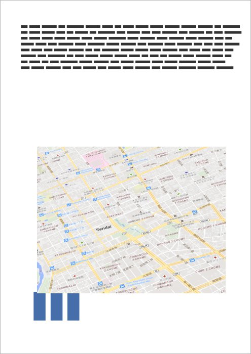 | 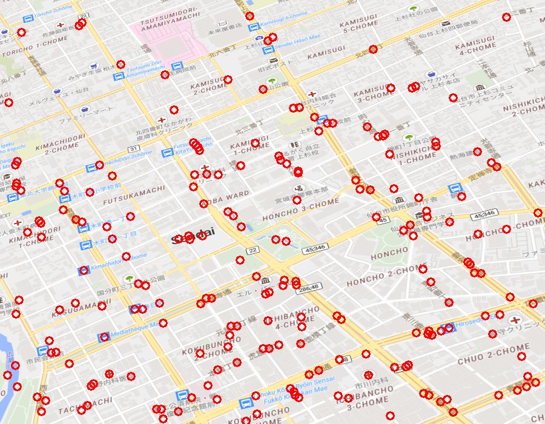 | 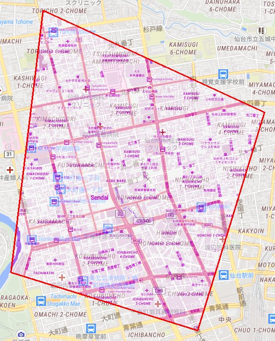 |

地図: [© OpenStreetMap contributors](https://www.openstreetmap.org/copyright)

ズーム 16 の地図に透視の歪みを掛け、文書に入れたもの。CHUO、FUTSUKAMACHI、ICHIBANCHO 3-CHOME など 15 の地名が 1 つの縮尺と向きにそろいました。GCP 207 点、誤差は最大 0.49 m です。

#### メルボルン (英語の地図)

| 文書のページ | 道具が取り出した地図と GCP | 結果 |
|---|---|---|
| 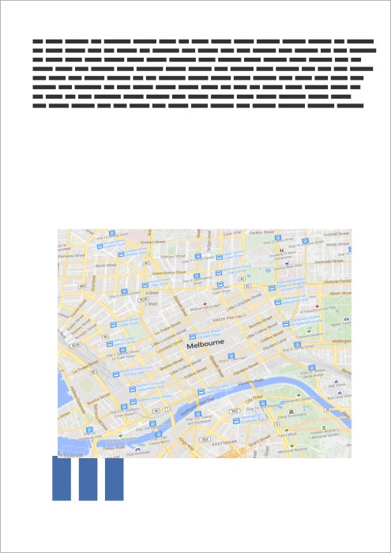 | 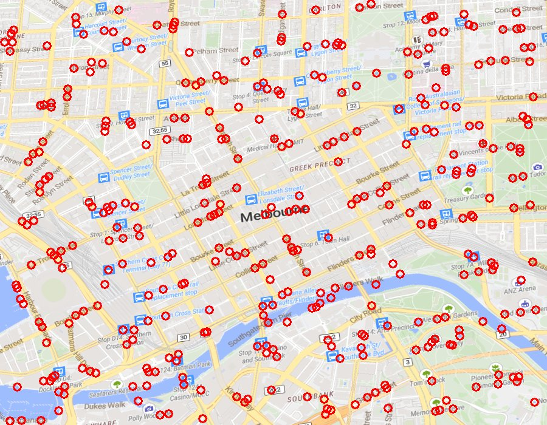 | 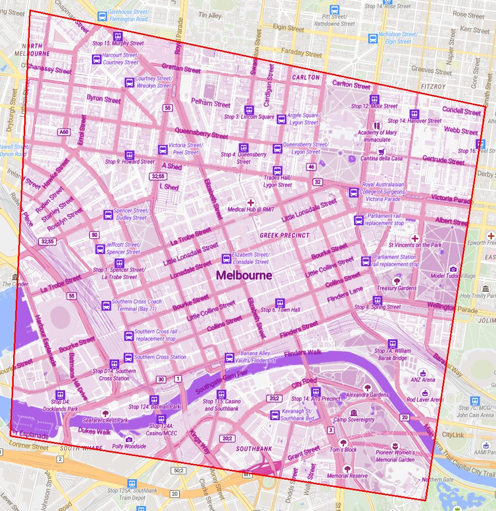 |

地図: [© OpenStreetMap contributors](https://www.openstreetmap.org/copyright)

ズーム 15 の地図に透視の歪みを掛け、文書に入れたもの。Byron Street、CARLTON、Gertrude Street など 7 つの地名がそろいました。GCP 363 点、誤差は最大 0.39 m です。

### 高度版: ページ全体を 1 枚の画像にしたスキャン

紙をスキャンしたのと同じ形の PDF です。地図は画像として分かれておらず、ページの絵の中から地図の範囲を探して切り出します。左の図の赤紫の枠が、道具が切り出した範囲です。地図の下の棒グラフの一部まで入っていますが、位置合わせはその部分を使わずに通りました。

#### 仙台 (日本語の地図)

| 文書のページ | 道具が取り出した地図と GCP | 結果 |
|---|---|---|
| 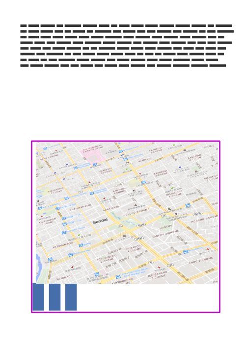 | 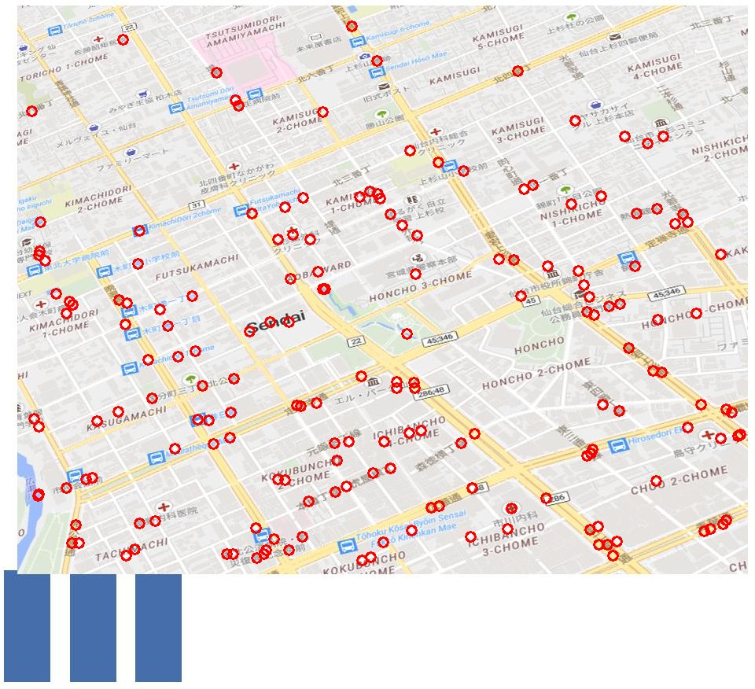 | 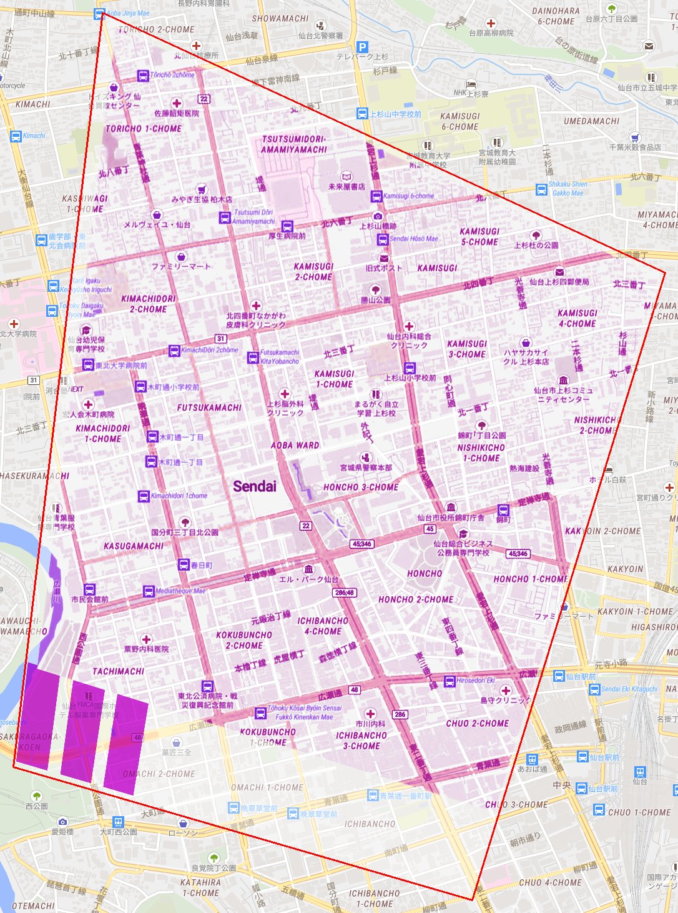 |

地図: [© OpenStreetMap contributors](https://www.openstreetmap.org/copyright)

簡易版と同じ地図です。AOBA WARD、FUTSUKAMACHI、HONCHO 2-CHOME など 15 の地名がそろいました。GCP 175 点、誤差は最大 1.29 m です。

#### メルボルン (英語の地図)

| 文書のページ | 道具が取り出した地図と GCP | 結果 |
|---|---|---|
| 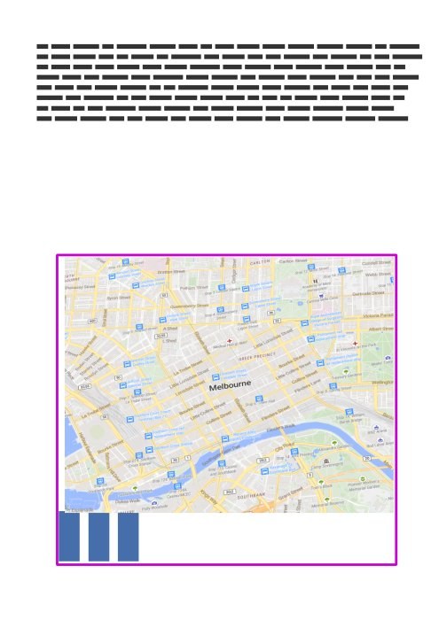 | 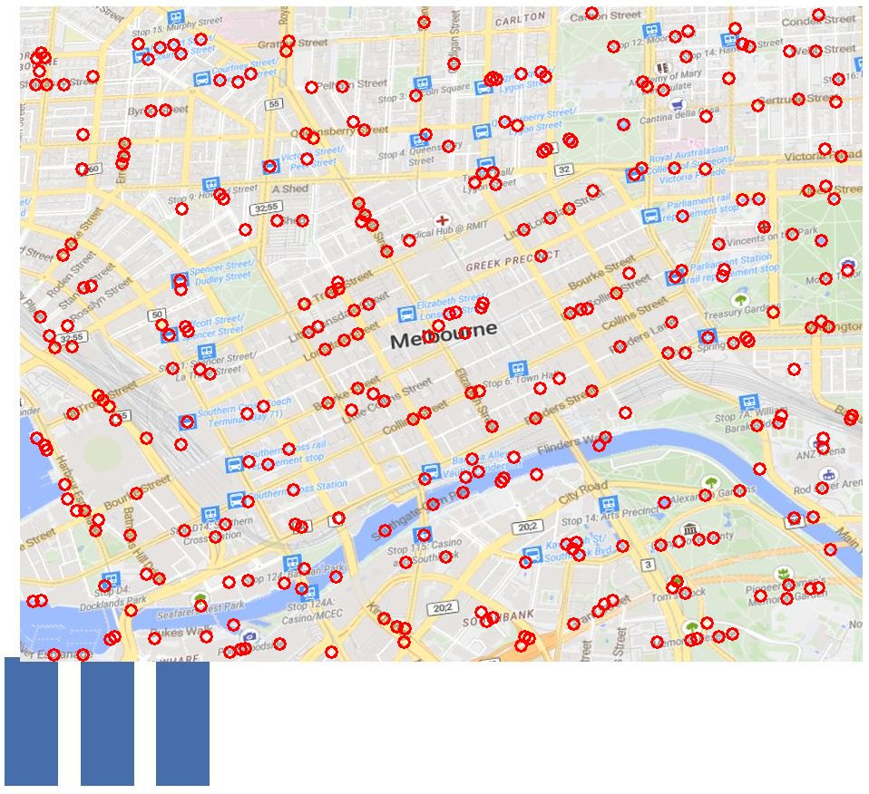 | 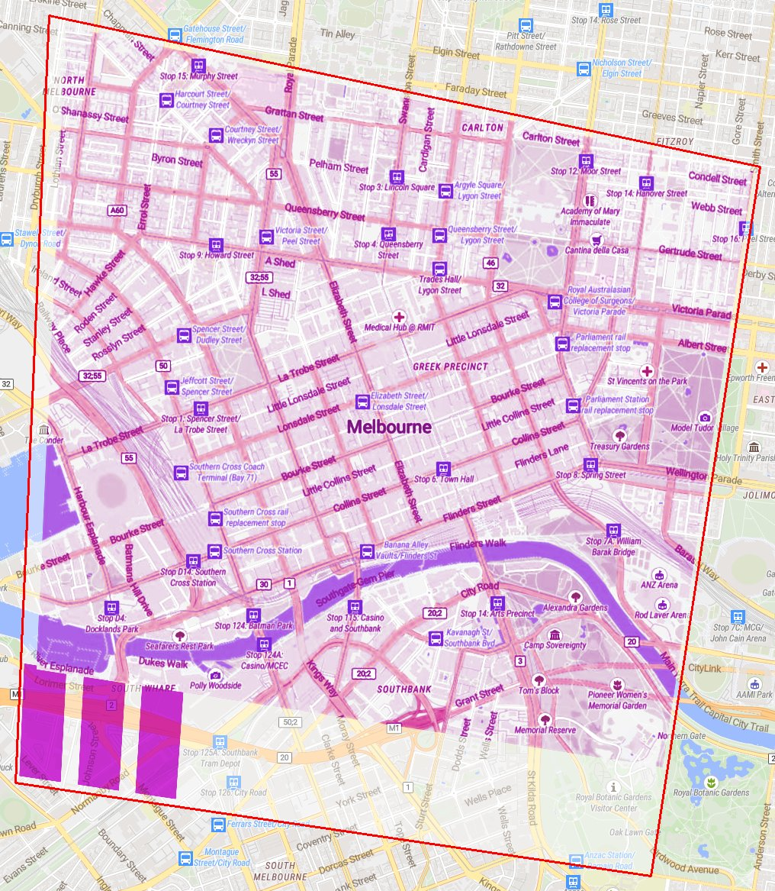 |

地図: [© OpenStreetMap contributors](https://www.openstreetmap.org/copyright)

簡易版と同じ地図です。Collins Street、Flinders Street など 10 の地名がそろいました。GCP 310 点、誤差は最大 1.74 m です。

スキャンでは、地図が 150 dpi のページの絵から切り出されるので、誤差は埋め込みより大きくなります。それでも、画像の半径の 0.1% 以内に収まっています。

### 評価

最初の評価は、静岡、仙台、メルボルン、シアトルの 16 枚の地図を、地図を画像として埋め込んだ PDF と、ページ全体を 150 dpi でスキャンした形の PDF に入れた 64 課題です。

| 文書 | 正解 | 失敗を宣言 | 関門が正しい答えを落とした | 誤った答え |
|---|---:|---:|---:|---:|
| 埋め込み | 14 | 17 | 1 | 0 |
| スキャン | 13 | 18 | 1 | 0 |
| 埋め込み (候補を 1 つの順位にした版) | 14 | 17 | 1 | 0 |
| スキャン (同上) | 10 | 20 | 2 | 0 |

地図を見つける段で外れた課題はありませんでした。止まった 35 件のうち 34 件は、レベル 4 と同じ、地名から場所や縮尺を決める段です。そろう地名が足りないものが 19 件、地名どうしの縮尺と向きが合わないものが 15 件でした。スキャンと埋め込みで、止まり方に大きな違いはありません。

候補を 1 つの順位にした版では、スキャンの正解が 13 から 10 に減りました。切り出した地図の画素は前の版と同じで、違いは地図の下の棒グラフが入るかどうかだけでした。それでも地名を読む段 (tesseract) が読む語が変わり、地名が足りずに止まりました。地図を見つける段ではなく、地名を読む段の揺らぎです ([記録](docs/failures/2026-11-04-level5-documents.md))。

## レベル 6: 地図の中身を地理空間情報に戻す (マイルストーン)

位置を合わせることは、それ自体が目的ではありません。地図に描かれた情報、たとえば浸水した範囲、計画区域、凡例で塗り分けた区域を、座標を持つデータ (GeoJSON) として取り出せて初めて、ほかのデータと重ねて使えます。レベル 1〜5 の位置合わせは、このための土台です。

考えている手順は、レベル 5 で位置を合わせた地図から、凡例の見本の色に近い画素を取り出し、文字の縁などの雑音を落として面にし、位置合わせの変換で経緯度に写すことです。正解の無い実際の地図では、別の独立した記録との重なりで確かめ、それが一致度であって真の精度ではないことを書き分けます。

別の作業で、自治体の浸水実績図の PDF を町丁の境界に合わせて、凡例の 1 項目の範囲を GeoJSON にした例があり、その教訓を [docs/notes/2026-11-04-pdf-map-advice.md](docs/notes/2026-11-04-pdf-map-advice.md) にまとめています。

## 結果のまとめ

模擬の課題での結果です (2026-11-04)。「関門の穴」は、関門を全て通ったのに、正解から画像の半径の 1% 以上ずれた答えの数です。「対照の拒否」は、手がかりの枠を別の場所へ動かした課題を、正しく拒否した数です。

| レベル | 課題 | 正解 | 関門の穴 | 対照の拒否 |
|---|---|---:|---:|---:|
| 1 | 同じスタイル (z15、結果を見て直した課題) | 54/54 | 0 | 16/16 |
| 1 | 同じスタイル (z13 と z17、見ていない場所と種) | 32/32 | 0 | 4/4 |
| 2a | 同じスタイルの灰色と二値 | 64/72 | 0 | 6/6 |
| 2 | osm-bright | 15/24 | 0 | 6/6 |
| 2 | osm-carto | 13/24 | 0 | (同上) |
| 3 | 文字とアイコンを消した osm-liberty (見ていない場所と種) | 24/24 | 0 | 6/6 |
| 3 | e-paper-ez-sign、水も文字も無い (見ていないスタイル) | 9/16 | 0 | 2/2 |
| 3 | 鉄道だけ、川だけ (線幅 4) | 6/48 | 0 | 6/6 |
| 4 | 枠もズームも渡さない osm-liberty (見ていない場所、z14〜16、最初の版) | 6/48 | 0 | (対照なし) |
| 4 | 同上、地物の形で測る版 (ダブリン、シカゴ、バンクーバー、オークランド) | 27/48 | 0 | (対照なし) |
| 4 | 同上、地物の形で測る版 (松山、高松、長崎、青森) | 19/48 | 0 | (対照なし) |
| 5 | 同じ地図を PDF に入れたもの (埋め込みとスキャン、静岡、仙台、メルボルン、シアトル) | 27/64 | 0 | (対照なし) |
| 5 | 同上、候補を 1 つの順位にした版 | 24/64 | 0 | (対照なし) |

解けなかった課題のほとんどは、道具が失敗を宣言したものです。理由と、試して採らなかった直し方は [docs/failures/](docs/failures/) に残しています。

本番の評価には、USGS と DARPA の地質図の課題 AI4CMA を取っておき、開発中は読みません ([docs/datasets.md](docs/datasets.md))。

## 仕組み

1 つの課題は、次の順に道具を通ります。

1. `tile-reference`: 手がかりの枠とズームから、座標付きの参照の地図を作る。
2. `feature-registration`: 局所の特徴 (SIFT、ASIFT、勾配) で GCP を作る。同じか近い描き方向け。
3. `cross-style-registration`: 前の段が失敗を宣言したときだけ使う。水のマスクか線のマスクで粗く合わせ、升ごとの相互情報量で GCP を作る。
4. `gcp-refinement`: 外れた GCP を、上限 (全体の 10%) 付きで除き、何を除いたかを記録する。
5. `georef-gates`: 関門。点の数と広がり、1 点ずつ抜いたときの残差、縁での誤差の大きさ、変換の形 (裏返りや折れが無いか)、手がかりの枠との整合を確かめる。

場所の分からない地図には、別に `place-hint` があります。

| スキル | 役割 |
|---|---|
| [`tile-reference`](.agents/skills/tile-reference/SKILL.md) | 経緯度の枠とズームから、座標付きの参照の画像を作る |
| [`feature-registration`](.agents/skills/feature-registration/SKILL.md) | 局所特徴 (SIFT、ASIFT、勾配の強さ) で GCP を作る |
| [`cross-style-registration`](.agents/skills/cross-style-registration/SKILL.md) | 水や線のマスクで粗く合わせ、升ごとの相互情報量で GCP を作る |
| [`gcp-refinement`](.agents/skills/gcp-refinement/SKILL.md) | 外れた GCP を上限付きで除き、記録する |
| [`georef-gates`](.agents/skills/georef-gates/SKILL.md) | 答えを返す前の関門 |
| [`place-hint`](.agents/skills/place-hint/SKILL.md) | 地名を読んで (tesseract)、自前の Nominatim で引き、場所のあたりを付ける |

構成は、姉妹リポジトリ GeoAI-master-skills (`.agents/skills/<スキル>/` に手順、スクリプト、テスト) にならっています。

## 試してみる

[uv](https://docs.astral.sh/uv/) が要ります。タイルは tile.yuiseki.net から取ります。

```sh
# 課題を作る (正解は truth に分けて書く)
uvx --with numpy --with pillow --with opencv-python-headless python evals/scripts/make_task.py \
  --style osm-liberty --center 139.7528 35.6852 --zoom 15 --size 900 700 \
  --distortion projective --strength 1.0 --seed 1 --task-out tmp/t/task --truth-out tmp/t/truth
# 手がかりの枠で参照を作り、GCP を作り、外れた点を除き、関門を通す
uvx --with numpy --with pillow python .agents/skills/tile-reference/scripts/fetch_reference.py \
  --style osm-liberty --zoom 15 --bbox <hint.json の bbox> --out tmp/t/ref
uvx --with numpy --with opencv-python-headless python .agents/skills/feature-registration/scripts/register.py \
  tmp/t/task/image.png tmp/t/ref --out tmp/t/answer.json
uvx --with numpy python .agents/skills/gcp-refinement/scripts/refine_gcps.py tmp/t/answer.json --out tmp/t/refined.json
uvx --with numpy python .agents/skills/georef-gates/scripts/check_gcps.py tmp/t/refined.json --hint tmp/t/task/hint.json
# 正解と比べる
uvx --with numpy --with pyproj python evals/scripts/score_task.py tmp/t/refined.json tmp/t/truth/truth.json
```

全てのテストは `python3 run_tests.py` で流せます。この README の図は `docs/examples/make_example.py` で描いています。

## ドキュメント

- [AGENTS.md](AGENTS.md): エージェントへの指示と、失敗からスキルを育てる手順
- [docs/curriculum.md](docs/curriculum.md): レベル 1〜5 の課題の作り方、歪み、採点、関門
- [docs/datasets.md](docs/datasets.md): 本番用に取っておく AI4CMA と、開発に使う tile.yuiseki.net
- [docs/failures/](docs/failures/): 失敗の記録と、そこから直したこと
- [docs/related-work.md](docs/related-work.md): 先行の仕事 (uncharted-ta1、DIGMAPPER など) と、そこから取り入れること

## ライセンス

コードと文書は [Apache License 2.0](LICENSE) です。

図に写っている地図: [© OpenStreetMap contributors](https://www.openstreetmap.org/copyright)。タイルは tile.yuiseki.net で描いたものです。地図のデータは、OpenStreetMap のライセンス (ODbL) に従います。
