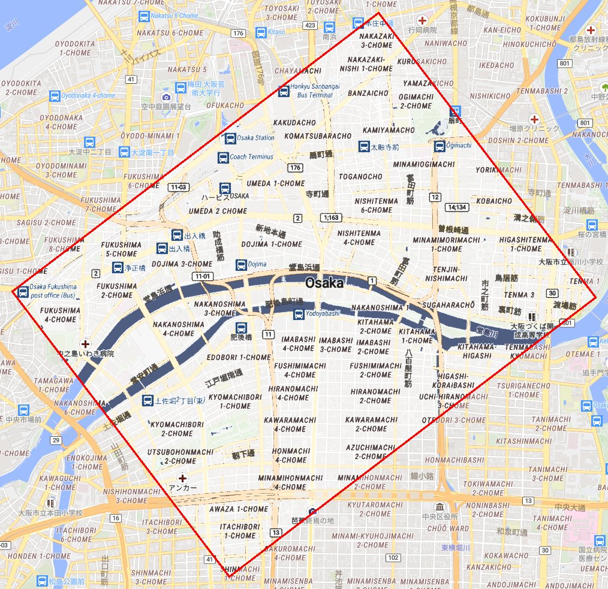
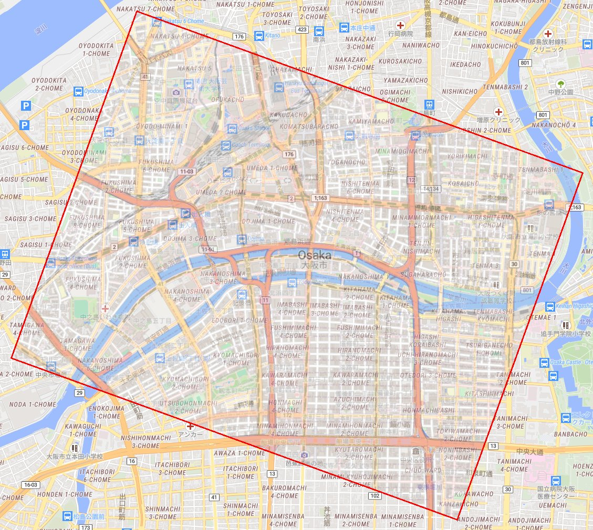
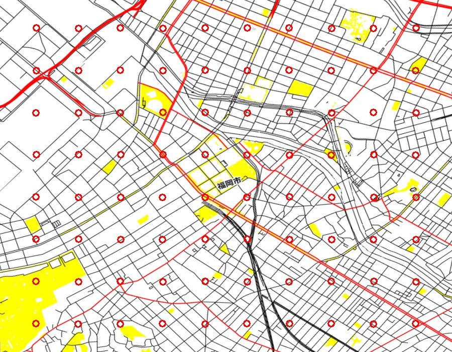
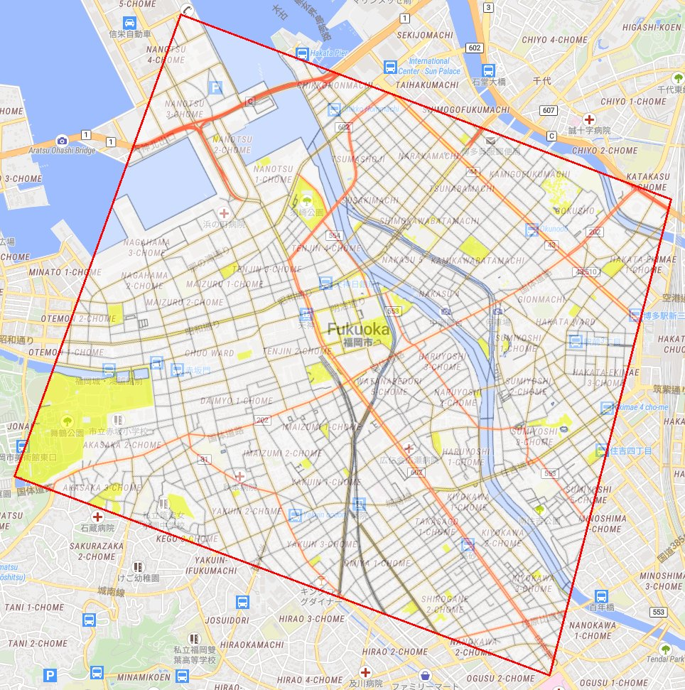
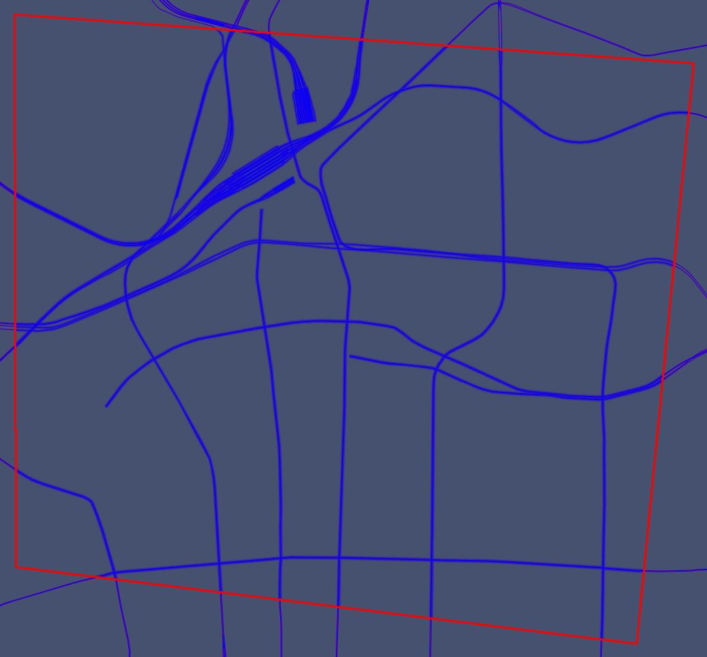
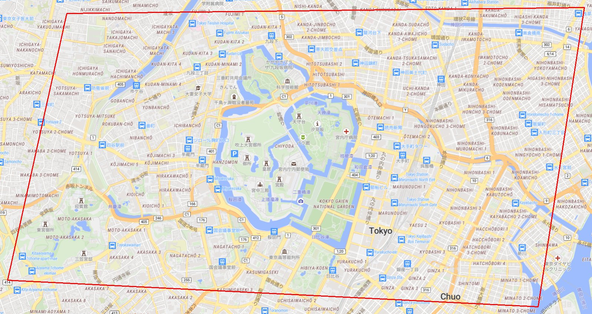
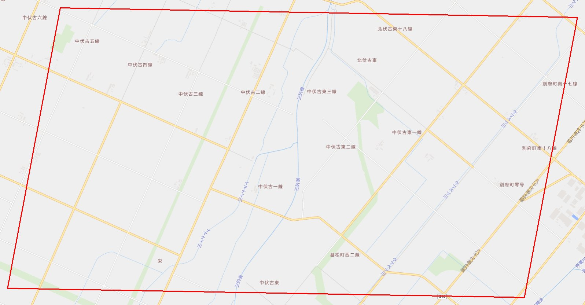

# Geo-Ref-skills

紙の地図や文書の図を、地上の座標に結び付ける作業 (ジオリファレンス) を、コーディング AI エージェントが間違えずに進めるためのスキルとハーネス。

## どこまでできたか (2026-11-04 時点)

課題は、易しい順にレベル 1〜5 に分けている ([docs/curriculum.md](docs/curriculum.md))。今はレベル 3 まで手を付け、レベル 4 と 5 はまだ道具が無い。

| レベル | どんな地図か | 進み具合 | 一言で |
|---|---|---|---|
| 1 | 参照と同じ描き方の地図を歪ませたもの | できた | 見ていない場所とズームでも 32/32 正解 |
| 2a | 同じ描き方を、灰色や白黒にしたもの | ほぼできた | 64/72。解けないのは白黒の畑の地図 |
| 2 | 配色も線の太さも違う描き方の地図 | 半分ほど | 37/64。水の無い場所、透視の歪みが苦手 |
| 3 | 川だけ、鉄道だけの地図 | 始めたところ | 6/48。線が少ない地図はどの道具でも決まらない |
| 4 | 場所の分からない、ただの「地図の画像」 | 準備中 | 地名から場所のあたりを付ける道具 (place-hint) だけある |
| 5 | PDF や文書の中に入っている地図 | 未着手 | 取り出し方を調べ、自前で作る方針を決めた |

一番大事な結果: どのレベルでも、関門を通ったのに場所が間違っている答えは 0 件。わざと別の場所の手がかりを渡した陰性の対照 (40 件) も、全て拒否した。解けない課題では、道具は「解けない」と宣言して止まり、もっともらしい間違いを返さない。

まだできないこと:

- 水の青も文字も無い地図で、描き方が違うもの (レベル 2 の一部、レベル 3 の多く)。
- 透視の歪みが強く、描き方も違う地図 (粗い探索が回転と縮尺しか試さない)。
- レベル 3 で、正しい答えなのに関門が拒否する 10 件。原因はまだ分からない。
- 手がかりの枠を渡さずに、場所を探すところから解くこと (レベル 4)。
- 文書から地図の部分を切り出すこと (レベル 5)。markitdown は使わず、pypdfium2 と zipfile で自前に作る案 ([docs/notes/](docs/notes/2026-11-03-document-map-extraction.md))。

本番の評価には、AI4CMA (USGS と DARPA の地質図の課題) を取っておき、開発中は読まない ([docs/datasets.md](docs/datasets.md))。

### レベルごとの実例

どの例も、左が道具に渡した歪んだ地図 (赤い丸は見つけた GCP)、右が答えの変換で地上に戻した地図を、参照の地図に半透明で重ねたもの。位置が合っていれば道路や線は 1 本に重なり、ずれていれば二重に見える。描き方が違う例では、2 つの描き方の線が同じ所に重なっているのが見える。赤い枠は、入力の画像の範囲を地上に写したもの。誤差は、正解の変換と比べた値。

レベル 2a: 白黒にした地図を、色付きの参照に合わせる (大阪、GCP 163 点、誤差は最大 0.94 m)

| 入力 | 結果 |
|---|---|
|  |  |

レベル 2: osm-carto で描いた地図を、osm-liberty の参照に合わせる (大阪、GCP 75 点、誤差は最大 2.16 m)。局所の特徴では合わず、水の青で粗く合わせてから、升ごとに合わせ込んだ。

| 入力 | 結果 |
|---|---|
|  |  |

レベル 2: 開発中に見ていない e-paper (黒、白、赤、黄の 4 色、水も白) の地図に、透視の歪みを掛けたもの (福岡、GCP 80 点、誤差は最大 1.83 m)。水の手がかりが無いので、道路の中心線どうしで合わせた。

| 入力 | 結果 |
|---|---|
|  |  |

レベル 3: 鉄道だけの地図 (大阪、GCP 55 点、誤差は最大 2.48 m)。文字も色の手がかりも無く、線の形だけで合わせた。

| 入力 | 結果 |
|---|---|
|  |  |

レベル 3 で、道具が「解けない」と宣言して止まった例 (金沢の鉄道)。線が 2 本ほどしか無く、場所を決める手がかりが足りない。升ごとの照合で 1 つの変換に乗った升は 4 個で、下限の 12 に届かなかった。もっともらしい答えを作らず、理由を付けて止まるのが、ここでの正しい振る舞い。


## 使い方の実例 (レベル 1)

歪んだ地図の画像と、だいたいの場所 (経緯度の枠とズーム) を渡すと、画像の画素と地上の経緯度の対応 (GCP) と、画像全体を地上に写す変換を返す。返す前に関門を通し、通らなければ答えを出さずに止まる。

下の 2 例は、地図のタイル (osm-liberty、z15) を、正解の分かる歪みで 900 x 700 画素に描き直した課題。歪みは、縮尺 1.31 倍、縦横比 1.20、せん断 -0.14 (東京はさらに射影)。道具だけで解き (エージェントは使っていない)、正解の変換と比べて誤差を測った (2026-11-03)。

### 東京の都心 (射影の歪み)

| 入力: 歪んだ地図と、見つけた GCP (赤い丸) | 結果: 地上に戻した地図を、元の地図に半透明で重ねたもの |
|---|---|
|  |  |

GCP 268 点、関門は全て通過。正解との誤差は最大 1.63 m、中央値 0.43 m (画像の範囲は地上で約 5.4 km x 3.2 km)。同じ描き方なので、位置が合っていると重ねた跡が見えないほど一致する (ずれていれば文字や道路が二重になる)。赤い枠は、入力の画像の範囲を地上に写したもの。

### 十勝の畑 (地物がまばらで、強いアフィンの歪み)

| 入力 | 結果 |
|---|---|
|  |  |

普通の SIFT では対応が足りず、最初は失敗を宣言していた例。失敗を記録し、崩れた前提 (SIFT は縦横比やせん断に強くない) を確かめて、傾きを模した見え方からも特徴を取る ASIFT をスキルに足した後に解けた。GCP 36 点、誤差は最大 2.66 m、中央値 0.76 m (範囲は約 4.9 km x 2.7 km)。

### 自分で流すには

```sh
# 課題を作る (正解は truth に分けて書く)
uvx --with numpy --with pillow --with opencv-python-headless python evals/scripts/make_task.py \
  --style osm-liberty --center 139.7528 35.6852 --zoom 15 --size 900 700 \
  --distortion projective --strength 1.0 --seed 1 --task-out tmp/t/task --truth-out tmp/t/truth
# 手がかりの枠で参照を作り、対応を取り、外れた点を除き、関門を通す
uvx --with numpy --with pillow python .agents/skills/tile-reference/scripts/fetch_reference.py \
  --style osm-liberty --zoom 15 --bbox <hint.json の bbox> --out tmp/t/ref
uvx --with numpy --with opencv-python-headless python .agents/skills/feature-registration/scripts/register.py \
  tmp/t/task/image.png tmp/t/ref --out tmp/t/answer.json
uvx --with numpy python .agents/skills/gcp-refinement/scripts/refine_gcps.py tmp/t/answer.json --out tmp/t/refined.json
uvx --with numpy python .agents/skills/georef-gates/scripts/check_gcps.py tmp/t/refined.json --hint tmp/t/task/hint.json
# 正解と比べる
uvx --with numpy --with pyproj python evals/scripts/score_task.py tmp/t/refined.json tmp/t/truth/truth.json
```

図は `docs/examples/make_example.py` で描いた。

地図: [© OpenStreetMap contributors](https://www.openstreetmap.org/copyright)。タイルは tile.yuiseki.net で描いたもの。

## 方針

- LLM や VLM の性能に頼らない。座標注記の構文解析、変換の推定、外れた対応点の除去、誤差の評価は、Python の決定論的な処理と古典的な機械学習の道具としてエージェントに渡す。
- エージェントが通る検証器 (関門) を用意する。対応点の数と配置、変換の残差、座標系の範囲を機械で確かめ、通らなければ止める。失敗を既定値や合成の点で埋めない。
- 道具と関門は、真の変換が分かる模擬のデータで採点してから使う。

構成は姉妹リポジトリ GeoAI-master-skills (`.agents/skills/<スキル>/` に手順、スクリプト、テスト、reference) にならう。

## 詳しい結果

模擬の課題 (tile.yuiseki.net のタイルに正解の分かる歪みを掛けたもの) での結果 (2026-11-04)。「関門の穴」は、関門を全て通ったのに正解と画像の半径の 1% 以上ずれた答え。陰性の対照は、手がかりの枠を別の場所へ動かした課題で、拒否するのが正しい。

| レベル | 課題 | 正確に解けた | 関門の穴 | 陰性の対照の拒否 |
|---|---|---:|---:|---:|
| 1 | 同じスタイル (z15、結果を見て直した 54 課題) | 54/54 | 0 | 16/16 |
| 1 | 同じスタイル (z13 と z17、見ていない場所と種) | 32/32 | 0 | 4/4 |
| 2a | 同じスタイルの灰色と二値 | 64/72 | 0 | 6/6 |
| 2 | osm-bright | 15/24 | 0 | 6/6 |
| 2 | osm-carto | 13/24 | 0 | (同上) |
| 2 | e-paper-ez-sign (見ていないスタイル) | 9/16 | 0 | 2/2 |
| 3 | 鉄道だけ、川だけ (線幅 4) | 6/48 | 0 | 6/6 |

- 解けなかった課題の多くは、失敗を宣言している (誤った答えは出していない)。理由と、試して採らなかった直し方は [docs/failures/](docs/failures/) にある。
- レベル 3 では、線が画像の 1% 未満の課題 (線が 1〜2 本) は全て失敗を宣言した。どの道具でも位置が決まらない。
- 場所の分からない地図に、地名からあたりを付ける place-hint は、見ていない 21 課題で、枠が正解を含む 10、誤った場所 0、失敗の宣言 11。

スキル:

| スキル | 役割 |
|---|---|
| `tile-reference` | 経緯度の枠とズームから、座標付きの参照の画像を作る |
| `feature-registration` | 局所特徴 (SIFT、ASIFT、勾配の強さ) で GCP を作る。同じか近いスタイル向け |
| `cross-style-registration` | 水のマスクか線のマスクで粗く合わせ、升ごとの相互情報量で GCP を作る。違うスタイル、線だけの地図向け |
| `gcp-refinement` | 外れた GCP を上限付きで除き、記録する |
| `georef-gates` | 答えを返す前の関門 (点の数と広がり、leave-one-out、縁の不確かさ、変換の形、手がかりの枠) |
| `place-hint` | 地名を読んで (tesseract)、自前の Nominatim で引き、場所のあたりを付ける |

全てのテストは `python3 run_tests.py`。

- [AGENTS.md](AGENTS.md): エージェントへの指示と、失敗からスキルを育てる手順
- [docs/curriculum.md](docs/curriculum.md): タイルから作る模擬の課題 (レベル 1〜5)、歪み、採点、関門
- [docs/datasets.md](docs/datasets.md): 本番用に取っておく AI4CMA と、開発に使う tile.yuiseki.net
- [docs/related-work.md](docs/related-work.md): 先行の仕事と、そこから取り入れること
