# Geo-Ref-skills

地図の画像が、地上のどこを描いたものかを求める作業 (ジオリファレンス) を、コーディング AI エージェントが間違えずに進めるためのスキルとハーネスです。

歪んだ地図の画像と、だいたいの場所を渡すと、画像の点と地上の経緯度の対応 (GCP、地上基準点) と、画像全体を地上に写す変換を返します。

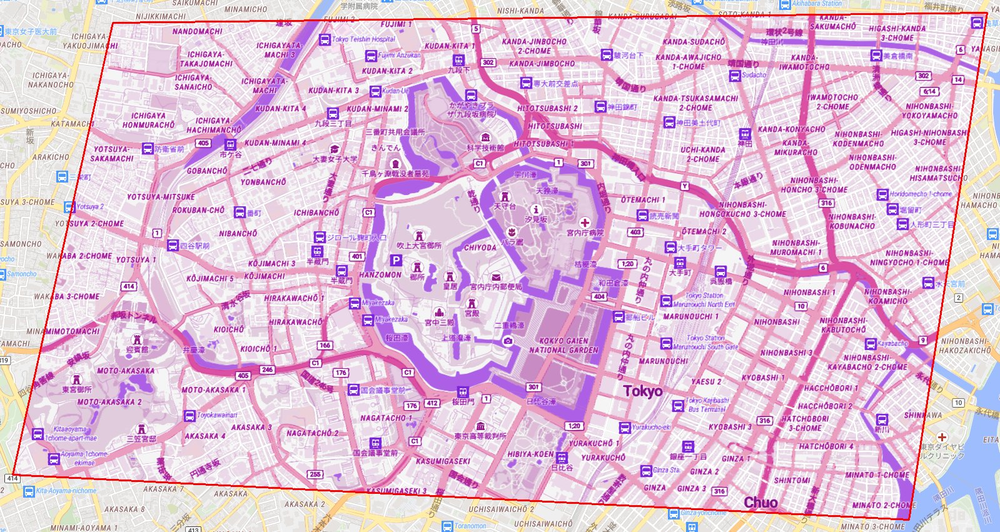

地図: [© OpenStreetMap contributors](https://www.openstreetmap.org/copyright)

## 考え方

- LLM や VLM に座標を推測させない。画像の照合、変換の推定、外れた点の除去、誤差の評価は、Python の決定論的な処理と古典的な機械学習の道具として、エージェントに渡します。
- 答えを返す前に、機械で確かめる関門を通します。点の数と広がり、変換の残差と形、縁での誤差の大きさ、手がかりの範囲との整合を確かめ、通らなければ止まります。
- 解けないときは、もっともらしい答えを作らず、理由を付けて「解けない」と宣言します。失敗を既定値や推測で埋めません。
- 道具と関門は、正解が分かる模擬の課題で採点してから使います。失敗した課題は記録し、崩れた前提を確かめて、スキルを直します ([AGENTS.md](AGENTS.md))。

## 模擬の課題とレベル

自前のタイルサーバー (tile.yuiseki.net) の地図に、正解の分かる歪み (回転、縮尺、せん断、透視など) を掛けて課題を作ります。易しい順にレベル 1〜5 に分け、下から順に解けるようにしています。その先のマイルストーンとして、地図の中身を地理空間情報に戻すレベル 6 を置いています ([docs/curriculum.md](docs/curriculum.md))。

| レベル | どんな地図か | 今の状況 (2026-11-10) |
|---|---|---|
| 1 | 参照と同じ描き方の地図 | できた |
| 2a | 同じ描き方を、灰色や白黒にした地図 | ほぼできた |
| 2 | 配色も線の太さも違う描き方の地図 | 半分ほど |
| 3 | 文字やアイコンを消した地図、水も文字も無い地図、川だけや鉄道だけの地図 | 文字の無い地図はできた、水も文字も無い地図は半分ほど、線だけの地図は始めたところ |
| 4 | 場所の分からない、ただの地図の画像 | 取っておいた課題で、日本の地図 48 のうち 36、世界の地図 48 のうち 44 を正解 (間違った答えは 0) |
| 5 | PDF や文書の中に入っている地図 | 模擬の文書は 64 のうち 27 を正解 (間違った答えは 0)。国連の PKO の地図は、1,310 件の PDF を全て通した |
| 6 | 位置を合わせた地図の中身を、GeoJSON に戻す | 国連の PKO の地図 2004〜2025 年の 365 地図から、部隊の配置 16,228 点を Hugging Face に公開した。WFP の道路状況図で道路の通行状況を線にして取り出せる (どちらも正解の無い実データ) |

レベル 1〜3 では、手がかりとして、余白付きの経緯度の枠とズームを渡します。手がかり無しで場所を探させると、探索が終わらなくなるおそれがあるためです。

関門を全て通ったのに正解から大きくずれた答え (関門の穴) は、取っておいたレベル 3 の線だけの地図の 1 件 (千葉の川、45 m) でした。縁の不確かさの上限を画像の大きさに合わせて締め、今の関門ではこの答えも落ちます。ただ、正確な答えの一部も一緒に落ち、新しい関門は、まだ取っておいた別の課題で確かめていません ([記録](docs/failures/2026-11-03-level3-lines.md))。わざと別の場所の手がかりを渡した対照の課題は、どのレベルでも全て拒否しました。

フロンティアでない汎用のコーディングエージェント (Codex と `gpt-6-luna`、Antigravity CLI と `gemini-3.8-flash-low`) にスキルを渡すと、どちらもレベル 1〜6 の課題を解きました。レベル 6 では、スキルを直す材料にしていない 4 枚の PKO の地図を両方とも 4/4 で解き、スキルを渡さないと 0/4 でした ([evals/agents/](evals/agents/README.md)、[結果](evals/agents/results.md))。

### 図の見方

以下の例は全て、道具だけで解いたものです (エージェントの判断は入っていません)。

- 左 (入力): 道具に渡した歪んだ地図。赤い丸は、道具が見つけた GCP。
- 右 (結果): 答えの変換で地上に戻した地図の道路、線、文字を赤紫で描き、淡く表示した参照の地図に重ねたもの。位置が合っていれば、赤紫は下の道路や文字にぴったり乗り、ずれていれば横に並んで二重に見えます。赤い枠は、入力の画像の範囲を地上に写したもの。
- 誤差は、正解の変換と比べた値です。

## レベル 1: 同じ描き方の地図

参照と同じスタイル (osm-liberty) の地図を歪ませた課題です。局所の特徴 (SIFT) を照合して GCP を作ります。

### 東京の都心 (透視の歪み)

| 入力 | 結果 |
|---|---|
| 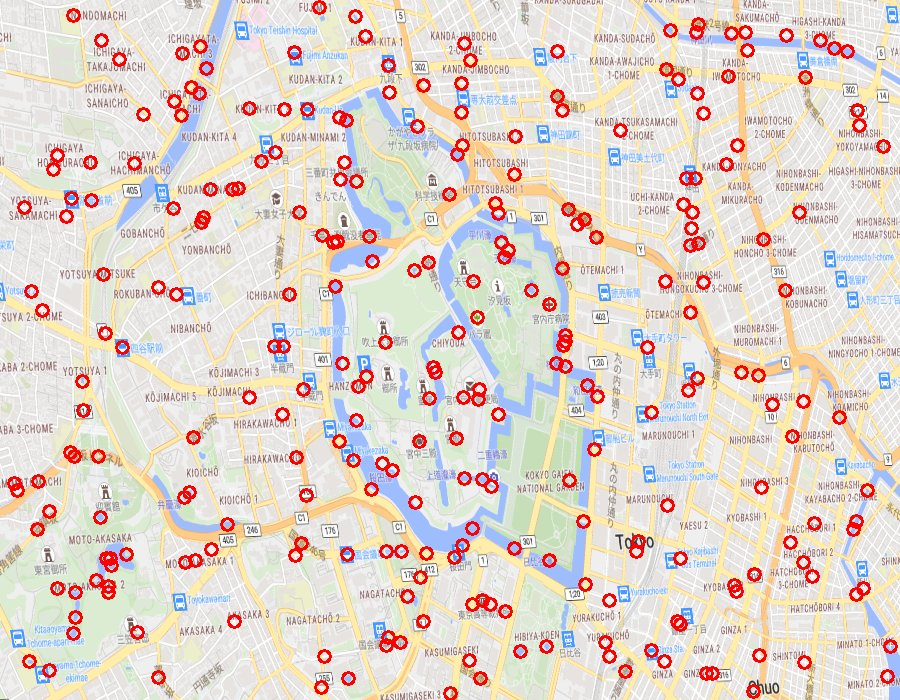 |  |

地図: [© OpenStreetMap contributors](https://www.openstreetmap.org/copyright)

GCP 268 点、関門は全て通過。誤差は最大 1.63 m、中央値 0.43 m です (画像の範囲は地上で約 5.4 km x 3.2 km)。

### 十勝の畑 (地物がまばらで、強いアフィンの歪み)

| 入力 | 結果 |
|---|---|
| 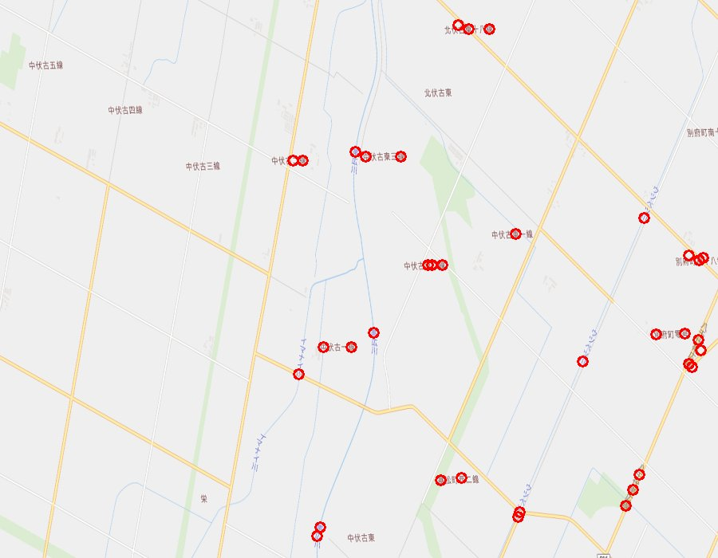 | 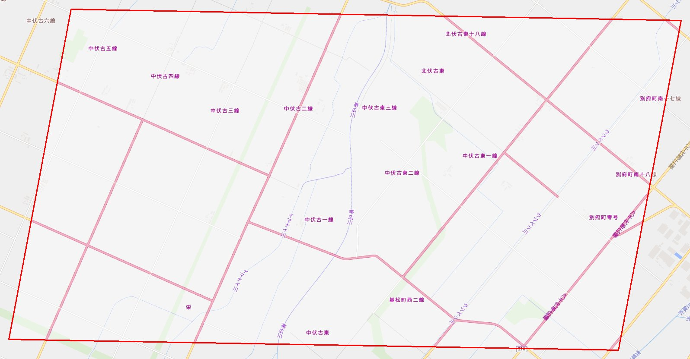 |

地図: [© OpenStreetMap contributors](https://www.openstreetmap.org/copyright)

GCP 36 点、誤差は最大 2.66 m、中央値 0.76 m です (範囲は約 4.9 km x 2.7 km)。

最初は普通の SIFT では対応が足りず、失敗を宣言していた例です。崩れた前提 (SIFT は縦横比やせん断の変化に弱い) を確かめ、斜めから見た見え方を模して特徴を取る ASIFT をスキルに足してから解けるようになりました。

開発中に結果を見て直した 54 課題は全て正解し、その後、見ていない場所、種、ズーム (z13 と z17) の 32 課題でも全て正解しました。

## レベル 2a: 灰色や白黒にした地図

白黒のコピーを模して、同じスタイルを灰色や二値にした地図を、色付きの参照に合わせます。色が無くなっても道路や建物の形は残るので、色に頼らずに照合します。

| 入力 | 結果 |
|---|---|
| 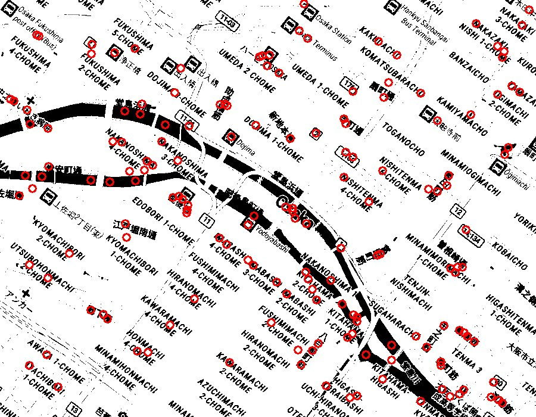 | 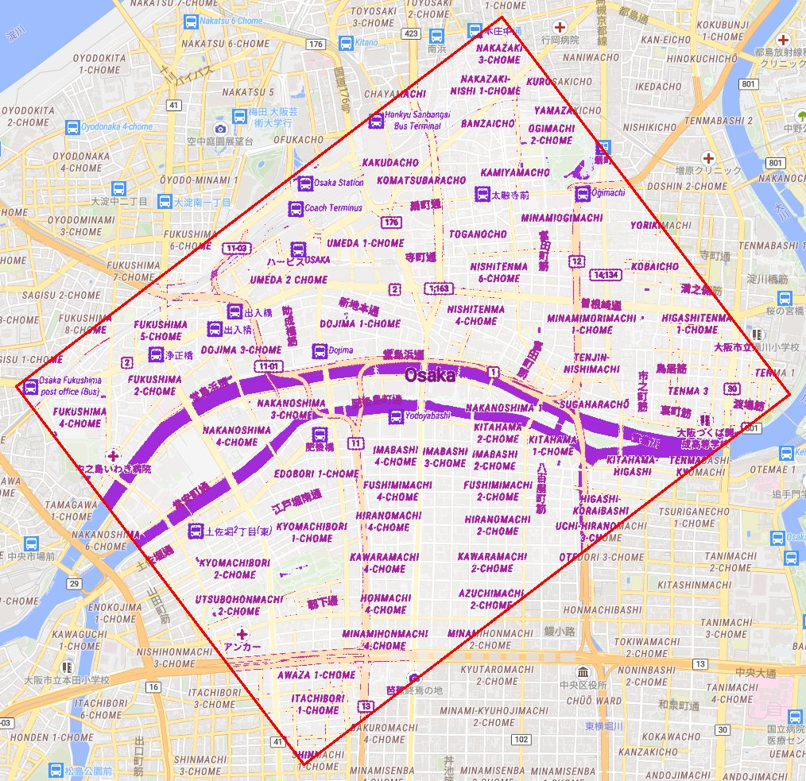 |

地図: [© OpenStreetMap contributors](https://www.openstreetmap.org/copyright)

大阪、GCP 163 点、誤差は最大 0.94 m です。72 課題のうち 64 課題を正解しました。解けなかったのは、二値にすると畑の区画がほとんど消える地図で、道具は失敗を宣言しています。

## レベル 2: 違う描き方の地図

配色、線の太さ、文字の位置が違うスタイルの地図を、osm-liberty の参照に合わせます。描き方が変わると局所の特徴が合わなくなるので、描き方が変わっても残るものを使います。

- 水は、ほとんどのスタイルで青く描かれる。水の青で粗く位置を合わせる。
- 色の対応が分からなくても、「この地図のこの色の所は、あの地図ではあの色」という関係は場所ごとに保たれる。小さな升ごとに、この関係 (相互情報量) が最も強くなる位置を探して合わせ込む。
- 升ごとの答えが 1 つの変換にそろうかどうかで、場所が正しいかを判定する。別の場所なら、升ごとの答えはばらばらになる。

### osm-carto の地図

| 入力 | 結果 |
|---|---|
| 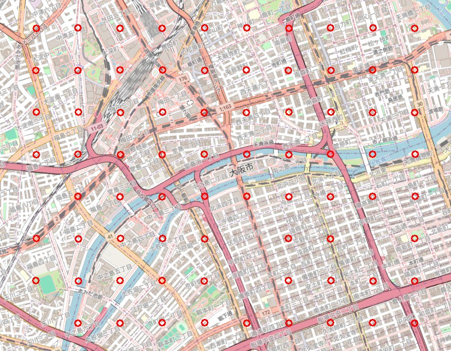 | 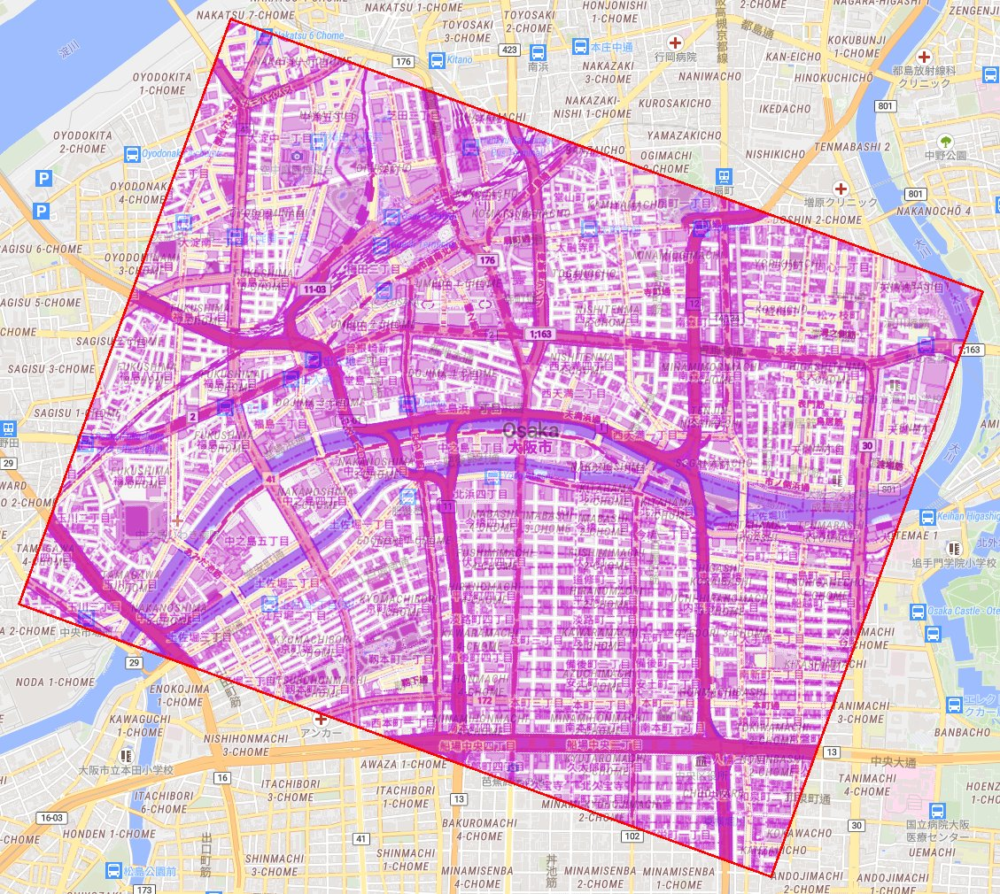 |

地図: [© OpenStreetMap contributors](https://www.openstreetmap.org/copyright)

大阪、GCP 75 点、誤差は最大 2.16 m です。

レベル 2 全体では 48 課題のうち 28 課題を正解しました。解けなかった 20 課題のうち 10 課題は、水の少ない旭川の郊外の地図です。

## レベル 3: 要素を絞った地図

参照より描かれているものが少ない地図です。3 種類を試しています。

### 文字とアイコンを消した地図

現実に多いのは、地名や記号の無い地図です。osm-liberty から文字とアイコンを消したスタイル (osm-liberty-no-text-no-icons) の地図を、文字のある普通の osm-liberty に合わせます。道路や水の形は残るので、局所の特徴の照合 (レベル 1 と同じ道具) で解けました。

| 入力 | 結果 |
|---|---|
| 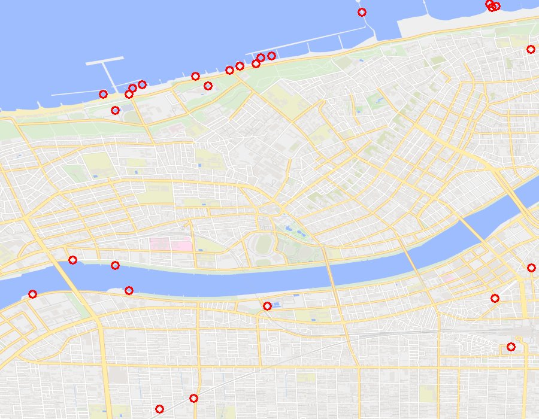 | 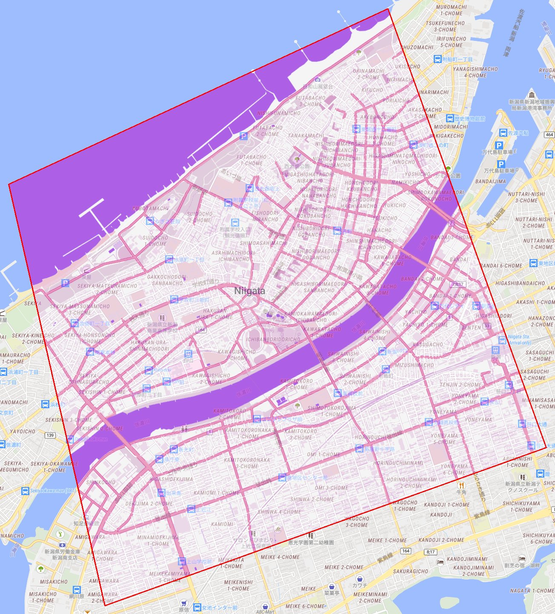 |

地図: [© OpenStreetMap contributors](https://www.openstreetmap.org/copyright)

新潟、GCP 27 点、誤差は最大 1.68 m です。開発中に使っていない広島、新潟、松本の 24 課題を全て正解し (誤差は最大 3.64 m)、別の場所の手がかりを渡した対照 6 件も全て拒否しました。

### 水も文字も無い地図 (e-paper、透視の歪み)

| 入力 | 結果 |
|---|---|
|  | 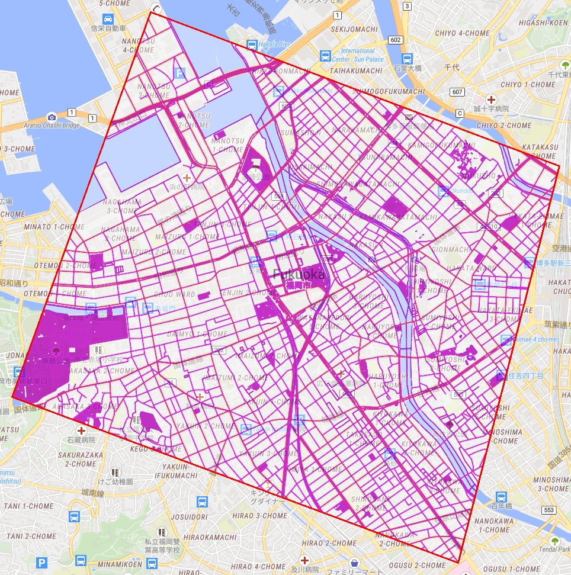 |

地図: [© OpenStreetMap contributors](https://www.openstreetmap.org/copyright)

黒、白、赤、黄の 4 色で描く、開発中に見ていないスタイル (e-paper-ez-sign) です。水を背景と同じ白で描き、文字もほぼ無く、残っているのは道路、鉄道、公園だけです。福岡、GCP 80 点、誤差は最大 1.83 m です。

レベル 2 の道具 (水の青で粗く合わせる方法) は「画像に水が無い」と失敗を宣言します。そのときだけ、次の手として、道路だけのスタイル (roads-minimal) を参照にして、道路の中心線どうしで合わせます。福岡と仙台の 16 課題のうち 9 課題を正解しました。

最初はスタイル名だけを見てレベル 2 に入れていましたが、描かれている中身 (水も文字も無い) と解き方から、レベル 3 に移しました (2026-11-04)。

### 川だけ、鉄道だけの地図

文字も色の手がかりも無く、線の形だけで合わせます。線の太さの違いを消すため、線を中心線に細めてから照合します。

| 入力 | 結果 |
|---|---|
| 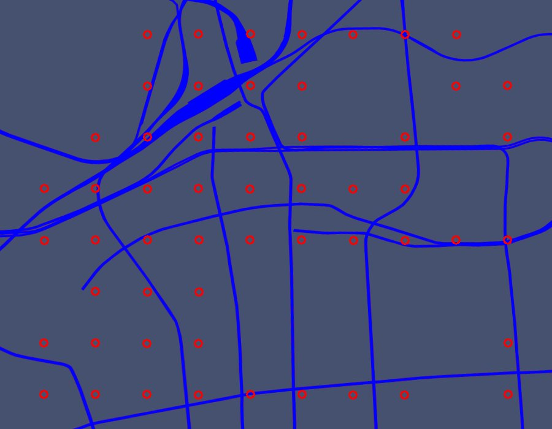 | 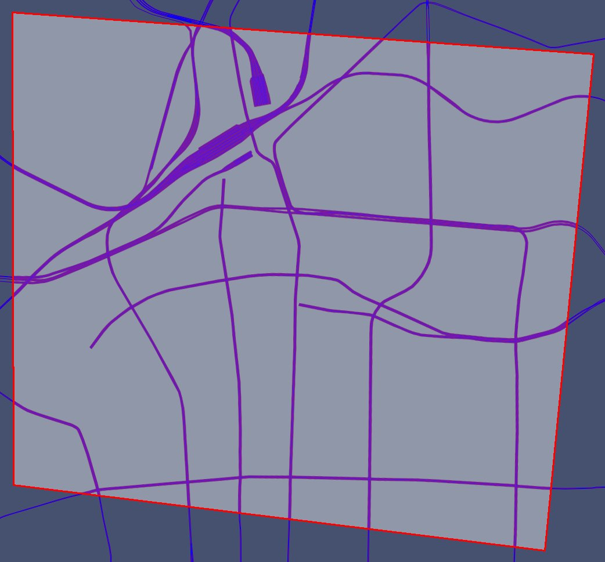 |

地図: [© OpenStreetMap contributors](https://www.openstreetmap.org/copyright)

大阪の鉄道、GCP 55 点、誤差は最大 2.48 m です。

### 解けないと宣言して止まった例


地図: [© OpenStreetMap contributors](https://www.openstreetmap.org/copyright)

金沢の鉄道の地図です。線が 2 本ほどしか無く、場所を決める手がかりが足りません。升ごとの照合で 1 つの変換にそろった升は 4 個で、下限の 12 に届かなかったため、道具は答えを出さずに止まりました。ここでは、これが正しい振る舞いです。

川だけ、鉄道だけの地図は、48 課題のうち 6 課題の正解にとどまっています。線が画像の 1% 未満の課題は、どの道具でも位置が決まりません。また、正しい答えなのに関門が拒否する課題が 10 件あり、原因はまだ分かっていません。

## レベル 4: 場所の分からない地図

手がかりの枠を渡さず、「これは地図です」とだけ言って画像を渡す課題です。場所を探すこと自体が課題になります。

地図の地名を読み (tesseract)、自前の Nominatim で引いて場所のあたりを付けます (`place-hint`)。さらに、名前が画像のどこに書かれているかと、地上のどこにあるかの組から、地図の縮尺、向き、ズーム、範囲を求めます。地上の位置は、自前の Overpass で取った地物の形で測ります。通りの名前は通りの線までの距離で、地区の名前は面の中ほどで測り、地図より広い地物は数えません。名前が十分な数 (4 つか 5 つ以上、かつ半分以上) 1 つの縮尺と向きにそろわなければ、失敗を宣言します。求めた範囲とズームで参照の地図を作り、あとはレベル 1 と同じ道具で合わせます。

縮尺の段で止まっても、町の名前 (Sapporo、Kanazawa など) が読めていれば、その名前のまわりにズームを変えた箱を置き、順に合わせて、関門を最初に通った答えを採ります (錨)。箱を全部別の町へずらした対照の課題 84 件は、全て拒否しました ([記録](docs/failures/2026-11-04-level4-names.md))。

### 盛岡

| 入力 (枠もズームも渡さない) | 結果 |
|---|---|
| 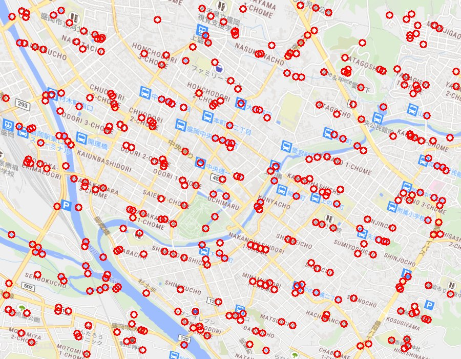 | 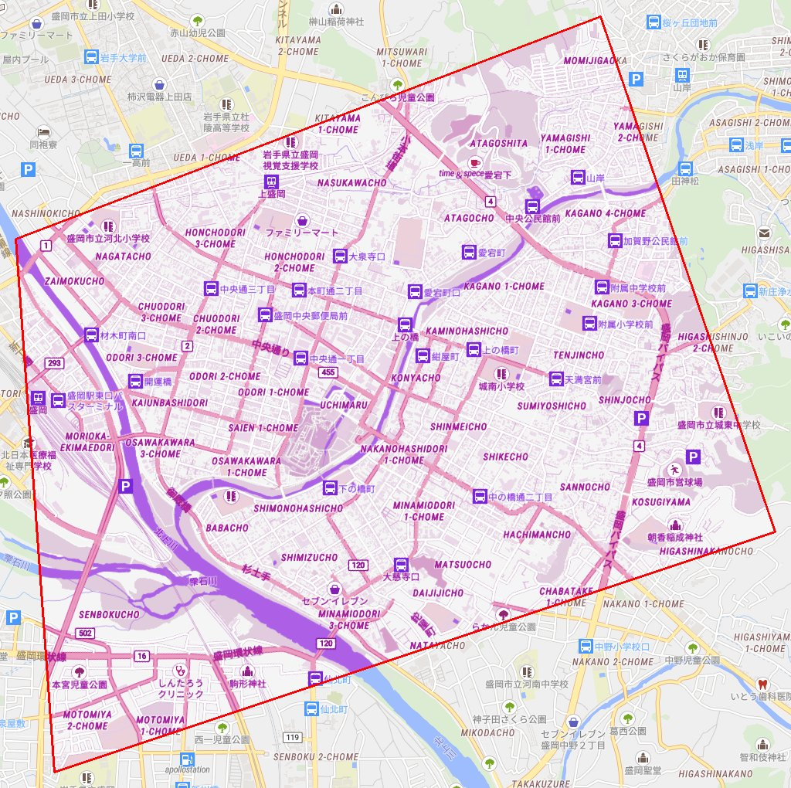 |

地図: [© OpenStreetMap contributors](https://www.openstreetmap.org/copyright)

ズーム 15 の地図に透視の歪みを掛けたもの。13 の地名のうち 10 が 1 つの縮尺と向きにそろい、ズーム 15 を選びました。GCP 351 点、誤差は最大 0.46 m です。

### ダブリン

| 入力 (枠もズームも渡さない) | 結果 |
|---|---|
| 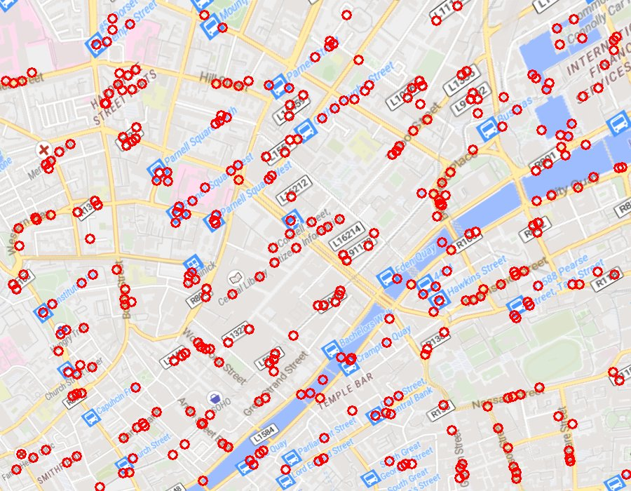 | 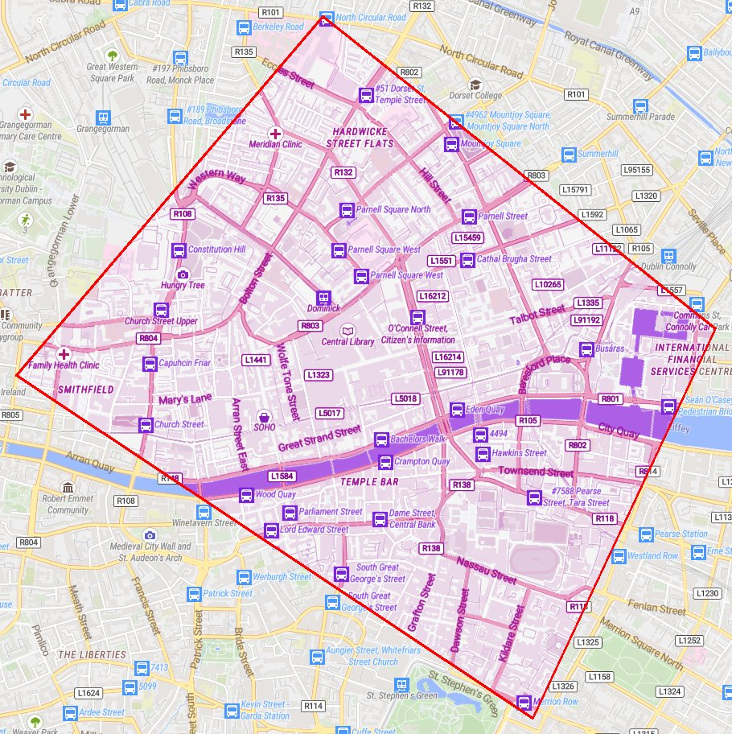 |

地図: [© OpenStreetMap contributors](https://www.openstreetmap.org/copyright)

ズーム 15 の地図に透視の歪みを掛け、35 度ほど回したもの。Nassau Street、Parliament Street、TEMPLE BAR など、場所の分かった 10 の地名のうち 6 つが 1 つの縮尺と向きにそろい、ズーム 15 を選びました。GCP 324 点、誤差は最大 0.25 m です。

### バンクーバー (ズーム 14)

| 入力 (枠もズームも渡さない) | 結果 |
|---|---|
| 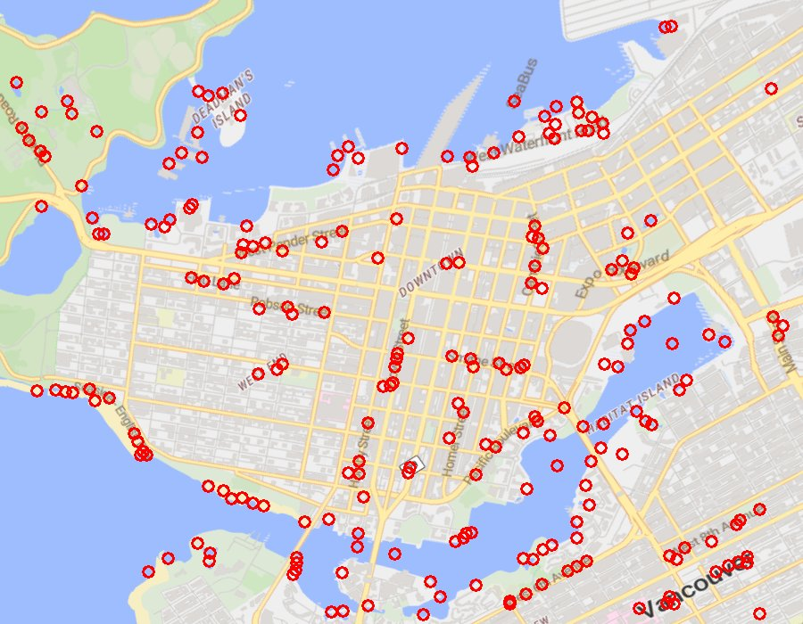 | 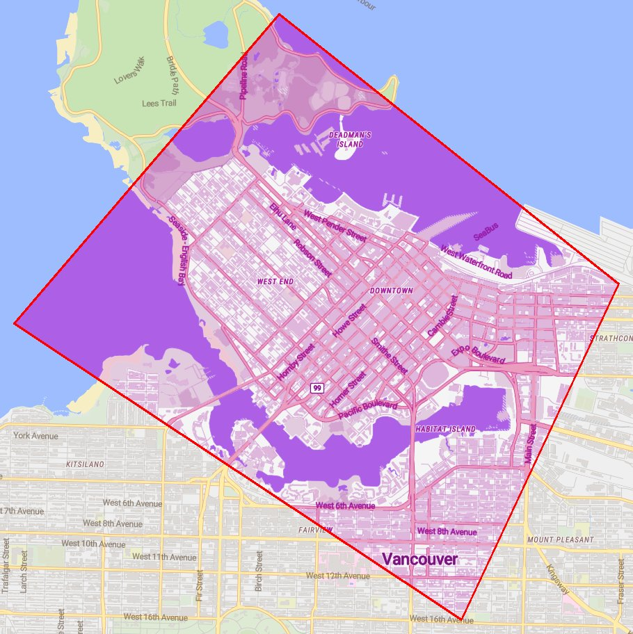 |

地図: [© OpenStreetMap contributors](https://www.openstreetmap.org/copyright)

文字の小さいズーム 14 の地図に、透視の歪みを掛けたもの。DOWNTOWN、WEST END、West Pender Street など、場所の分かった 5 つの地名が全て 1 つの縮尺と向きにそろい、ズーム 14 を選びました。GCP 221 点、誤差は最大 1.44 m です。

### 評価

開発中に使っていない場所の 48 課題ずつ (ズーム 14〜16、相似と透視の歪み) で試しました。

| 場所 | 正解 | 失敗の宣言 | 誤った答え |
|---|---|---|---|
| 名古屋、神戸、鹿児島、盛岡 (最初の版) | 6 | 42 | 0 |
| ダブリン、シカゴ、バンクーバー、オークランド | 27 | 21 | 0 |
| 松山、高松、長崎、青森 | 19 | 29 | 0 |

下の 2 行は、地物の形で測るようにした後の版です。どの評価でも、関門が誤った答えを通したことはありません。止まったのはほぼ全て、地名から場所や縮尺を決める段です。地名が途中で切れて読まれる、ズーム 14 では文字が小さく少ない、といった理由です ([記録](docs/failures/2026-11-04-level4-names.md))。

文字の無い地図 (レベル 3 の多く) には、この方法は使えません。

## レベル 5: 文書の中の地図

PDF、PowerPoint、Word、Excel の中から地図らしい画像を切り出し、レベル 4 の道具に渡す課題です。markitdown を使うかを調べたうえで、PDF は pypdfium2、Office の文書は zip の中の画像を直接取り出す形で、自前で作る方針にしました ([調べた記録](docs/notes/2026-11-03-document-map-extraction.md))。いまは PDF だけを扱います。

地図を見つける道具は [document-maps](.agents/skills/document-maps/SKILL.md) です。埋め込まれた画像、細切れに埋め込まれた画像をつなぎ直したもの、ページを描いた絵から切り出した矩形を、見た目の地図らしさとページに占める広さで 1 つの順位に並べます。順に レベル 4 の道具へ渡し、道具が失敗を宣言したときだけ次の候補へ進みます。

道具に渡すのは PDF と国だけです。地図がどこにあるか、どの場所の地図か、ズームはいくつかは渡しません。以下の例では、実際の PDF から地図を見つけ、地名から場所と縮尺を求め、位置を合わせるところまで、全て道具が行いました。右の図は、戻した地図を OSM に重ねたもので、海岸線や国境、川、道路が OSM と二重にならなければ合っています。

### 実際の文書: 国連の平和維持活動の地図

実際の PDF として、国連の地理空間情報部が公開している平和維持活動 (PKO) の地図を試しました ([一覧](docs/datasets.md))。国全体の主題図で、OSM の描画とは見た目が違うので、レベル 4 の画像の照合は成り立ちません ([最初の通し](docs/failures/2026-11-04-un-pko-maps.md))。

そこで、町の記号 (小さな輪や点) と、その横の町の名前から GCP を作る道具 [name-gcps](.agents/skills/name-gcps/SKILL.md) を足しました。文字を読み、自前の Nominatim で町の位置を引き、名前の位置で大まかな縮尺と向きを当ててから、名前ごとに近くの記号の候補を選んで当て直します。道具に渡すのは PDF と、地図の国と隣の国だけです。PDF から地図を見つけるところ (document-maps)、GCP を作るところ、関門まで、全て道具が行いました。

| 地図 | 結果 | GCP | LOO の最大 | 1 px の地上の長さ (およそ) |
|---|---|---:|---:|---:|
| UNMIK (コソボ) | 関門を全て通った | 36 | 2.1 px | 130 m |
| MINUSCA (中央アフリカ) | 関門を全て通った | 38 | 2.2 px | 1 km |
| UNMISS (南スーダン) | 関門を全て通った | 21 | 2.4 px | 1 km |

ミッションごとの最新の版 (2025 年) の地図です。この道具は、結果を見ながら直したので、ここに示すのは評価ではなく作例です。残る誤差は、地図の記号の位置と OSM の町の点の違いで、2 px 前後です。右の図は、戻した地図の線と文字を赤紫で、OSM の上に重ねたものです。地図の周りにも OSM を広く残しているので、海岸線、国境、川、湖、町の位置が、OSM のものと重なっていることを、地図の外側と見比べて確かめられます。赤い枠が地図の範囲です。

#### UNMIK (コソボ)

| 取り出した地図と GCP (赤い丸) | 結果 |
|---|---|
| 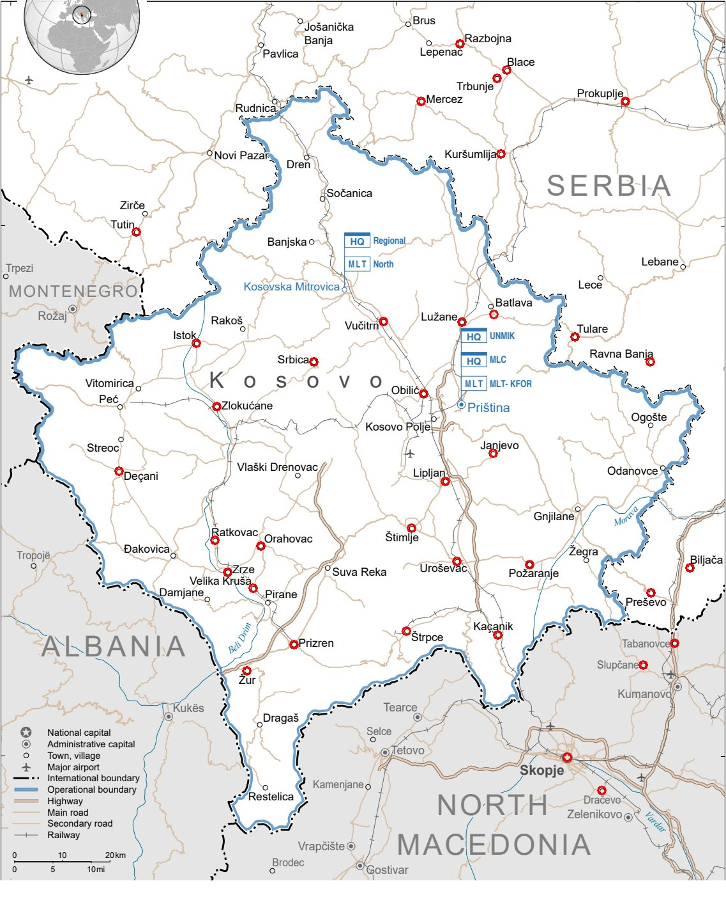 | 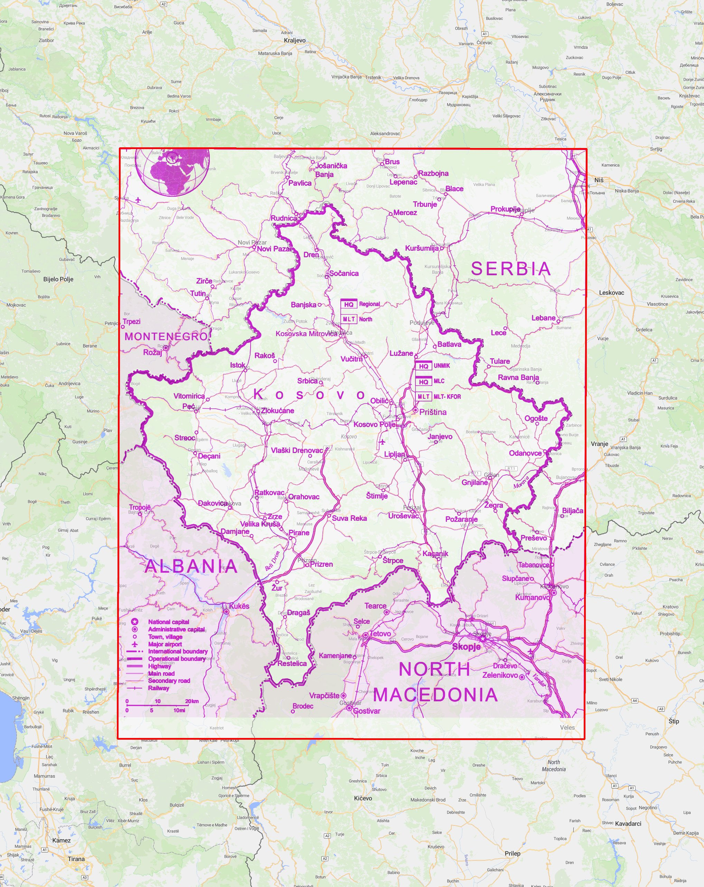 |

#### MINUSCA (中央アフリカ)

| 取り出した地図と GCP (赤い丸) | 結果 |
|---|---|
| 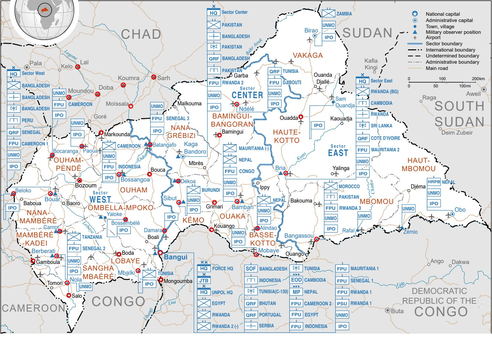 | 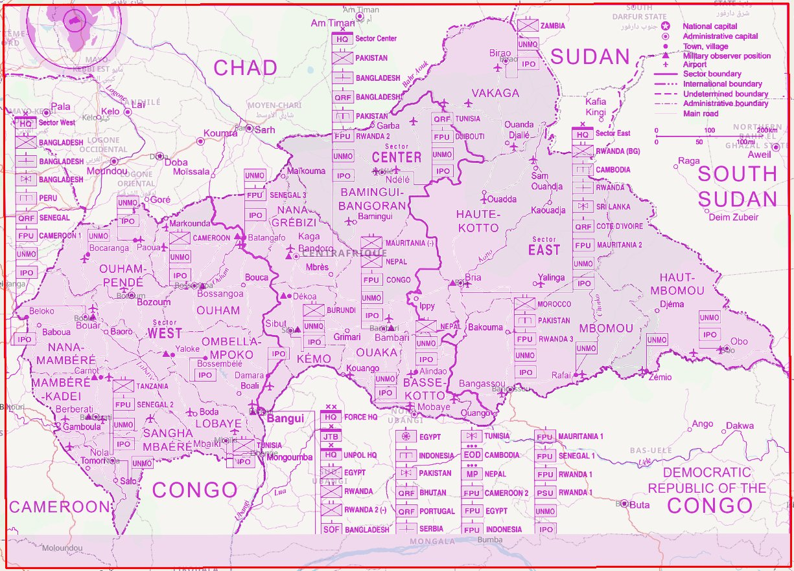 |

#### UNMISS (南スーダン)

| 取り出した地図と GCP (赤い丸) | 結果 |
|---|---|
| 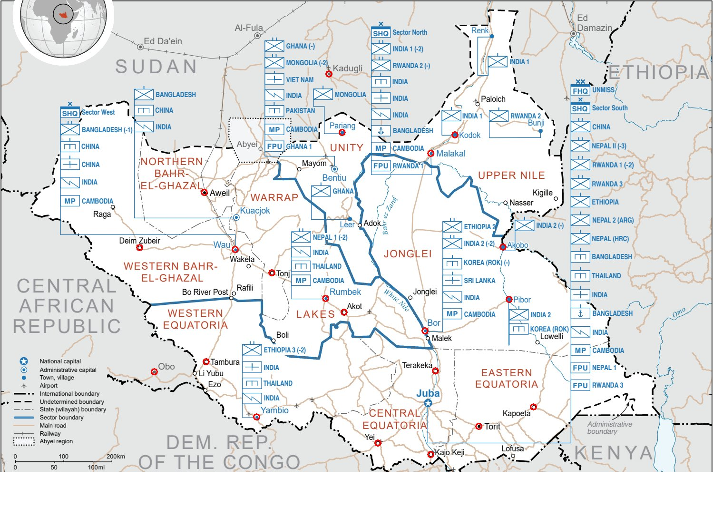 | 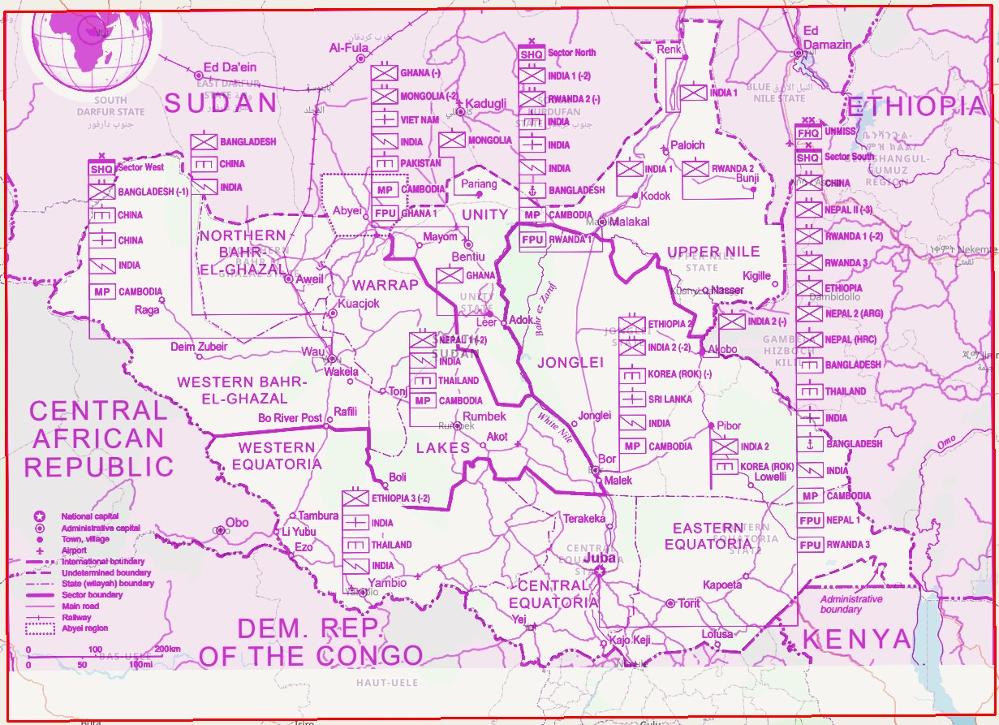 |

地図: based on United Nations map。国連の利用条件 ([Geospatial Information Section](https://www.un.org/geospatial/en/mandates/public)) に従い、図から国連の名称と地図の参照番号を消しています (`docs/examples/mask_un_marks.py`)。ミッションと部隊の略称 (UNMISS、UNMO など) は地図の記号の一部として残しています。右の図の背景: [© OpenStreetMap contributors](https://www.openstreetmap.org/copyright)。PDF そのものはリポジトリに入れていません。

## レベル 6: 地図の中身を地理空間情報に戻す

位置を合わせることは、それ自体が目的ではありません。地図に描かれた情報を、座標を持つデータ (GeoJSON) として取り出せて初めて、ほかのデータと重ねて使えます。レベル 1〜5 の位置合わせは、このための土台です。

いま動いているのは、国連の PKO の展開図 (部隊の配置) です。平和研究のために、部隊の配置を時系列の GeoJSON にすることを目指しています。LLM と VLM は使いません。次の 5 つのスキルで、PDF から GeoJSON まで、さらに軍事記号で地図を再現するところまで進めます。

| スキル | 役目 |
|---|---|
| [deployment-batch](.agents/skills/deployment-batch/SKILL.md) | PDF の束を、ミッション名と日付を読みながら、レベル 5 の道具で位置合わせする。関門を通した答えだけを残す |
| [graticule-gcps](.agents/skills/graticule-gcps/SKILL.md) | 地名で合わない地図を、枠の経緯度の目盛り (UNDOF) や UTM の方眼 (UNIFIL) で合わせる |
| [unit-symbols](.agents/skills/unit-symbols/SKILL.md) | 部隊の記号を読む。枠、国名の札、規模の印 (中隊、大隊など)、兵科、積み重なった記号と引き出し線。引き出し線の先が正確な位置 (国連軍事記号ハンドブック) |
| [deployment-geojson](.agents/skills/deployment-geojson/SKILL.md) | 記号の画像上の位置を、位置合わせの変換で経緯度に写し、公開できる形の GeoJSON にする |
| [deployment-render](.agents/skills/deployment-render/SKILL.md) | GeoJSON の点を、Wikimedia Commons の NATO APP-6 の軍事記号 (兵科の絵と規模の印) で OSM の上に描き、元の配置図を再現する |

下は、UNMISS (南スーダン) の 2025 年 5 月の地図から取り出した 77 部隊 (全部隊) の GeoJSON を、軍事記号にして OSM の上に描き直した図です。兵科の絵 (歩兵、医療、工兵、通信、憲兵、司令部) と、規模の印 (中隊は棒 1 本、大隊は棒 2 本、旅団は x) は、Wikimedia Commons の APP-6 の記号です。素材の無い兵科 (軍事監視員、FPU など) は、枠の中に略称を書いています。同じ場所に積み重なった記号は、赤い点 (GeoJSON の位置) から出した引き出し線の先に並べています。記号の箱の位置は正確ではなく、位置の正解は赤い点です。Juba の UNMISS 本部、各セクター司令部、国ごとの部隊が、それぞれの町や基地のあたりに落ちています。

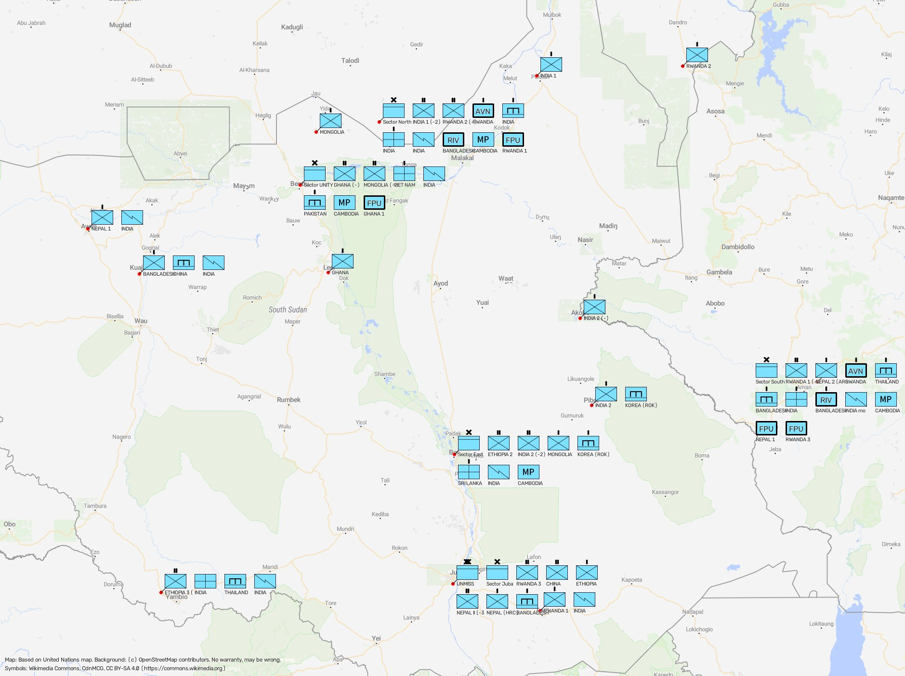

地図: based on United Nations map。背景: [© OpenStreetMap contributors](https://www.openstreetmap.org/copyright)。記号: [Wikimedia Commons](https://commons.wikimedia.org/wiki/Category:Tactical_signs_and_map_symbols_of_NATO) の CdnMCG による APP-6 の記号 (CC BY-SA 4.0)。素材はリポジトリに入れず、`fetch_symbols.py` で取ります。図は CC BY-SA 4.0 の条件 (表示と継承) に従って使ってください。

UNMISS の 2020 年 6 月から 2025 年 5 月までの 16 版 (同じ日付の重複は 1 つにまとめた) を、同じ地図の上で順に重ねると、配置の時系列変化になります。

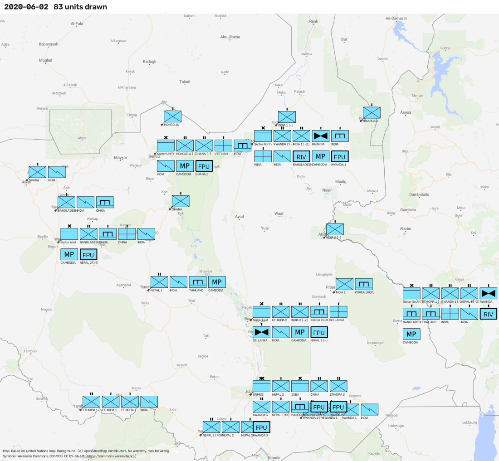

コマの日付は PDF の作成日で、地図が表す日付ではありません。部隊数の増減には、実際の変化と、位置の取りこぼしが混ざっています (位置が決まらなかった部隊は描かれません)。2026-11-06 に引き出し線のたどり方を直し、2022 年の 3 版 (76 のうち 72) を除く全ての版で、全部隊に位置が付きました。以前は 2023 年 2 月の版で 73 のうち 34 でした。また以前は、線の見つからない積みを隣の別の印に付けていて、Sector South が Juba でない場所に落ちていました。兵科は、16 版の全ての部隊で読めています。最初は 2020〜2022 年の版で兵科の絵を読めていませんでした。版によって同じ絵の線の分け方が違い、線の数で兵科を決めていたためで、同じ向きに続く線を 1 本に数えるように直しました。2022 年の 3 版は、地図全体の答えが関門を通らず、点ごとの確認で使ったもので、コマに印を付けています。

### 点を使う条件

点ごとの位置合わせの確かさを、位置合わせと同じく関門で縛ります。関門は緩めていません。

- 地図全体の答えが関門を全て通ったときだけ、その地図の点を全て使います。
- 拡大図 (インセット) や、町が地図の一部にしか無い地図は、広がりの関門だけを通らないことがあります。その場合も、地図全体の答えとしては捨てます。そのうえで、点ごとに次の 2 つを満たす点だけを使います。
  - 控えの GCP の凸包の中にある (外への外挿は、残差に表れずにずれるため)。
  - GCP を 1 つずつ外したときの点の動きが 3 px 以下。
- 位置が決まらなかった記号は捨て、理由 (位置なし、地図の外、凸包の外、不確か) を数えて残します。

### 公開できる形

国連の利用条件に沿って、出力は派生物として扱います。

- 各 GeoJSON に "Based on United Nations map" を書く。国連の参照番号は、どこにも入れない。日付は入れる。
- 元の PDF の SHA-256 と、処理したツールのコミットハッシュを入れる (ツールのファイルが未コミットなら、出力を拒否する)。
- 「正確性は一切保証しない、間違っている可能性がある、absolutely no warranty」を、全体と各点に書く。

これは、位置合わせの一致度を確かめる関門を通った点であって、真の精度ではありません。

### 2025 年の全ミッション

2025 年の地図がある 9 ミッション、24 枚を GeoJSON にしました (2026 年の版はまだ手元にありません。MINURSO、UNMOGIP、UNTSO の最新は 2023〜2024 年です)。

| ミッション | 地図 | 部隊 | 位置が付いた部隊 | 基準点 |
|---|---|---|---|---|
| MINUSCA (中央アフリカ) | 3 | 314 | 314 | 地名 |
| UNMISS (南スーダン) | 4 | 308 | 308 | 地名 |
| MONUSCO (コンゴ民主共和国) | 4 | 272 | 244 | 地名 (拡大図は町が一列に並ぶため点ごと) |
| UNIFIL (レバノン) | 2 | 236 | 200 | UTM の方眼 |
| UNDOF (ゴラン高原) | 4 | 132 | 132 | 枠の経緯度の目盛り |
| UNFICYP (キプロス) | 2 | 50 | 46 | 地名 (点ごと) |
| UNMIK (コソボ) | 2 | 10 | 10 | 地名 |
| UNISFA (アビエイ) | 3 | - | - | 失敗 |
| 計 | 21 | 1,322 | 1,254 | |

ここまでに直したことは次のとおりです。

- MONUSCO の 2025 年の図は、下地の地図をフォーム XObject の中に描いていました。ページの直下だけを読んでいたため、引き出し線の先の町の点が見えず、68 部隊のうち 61 部隊で位置が付かないか、誤っていました (unit-symbols)。
- 引き出し線は木のように枝分かれします。別の線の上で終わる線をたどり、隣の積みの線と区別し、同じ大きさの川の曲がりを枠と読まないようにしました。関門を通った 2017〜2025 年の 142 枚で比べると、857 部隊に新しく位置が付き、768 部隊が隣の印から線の先へ移りました。
- UNDOF は地名で 7 点しか合わず (12 必要)、UNIFIL は 8 点でした。そこで、枠の経緯度の目盛りと UTM の方眼から基準点を作るスキル (graticule-gcps) を足しました。どちらも関門を全て通り、地名検索で位置の分かる町と 30〜450 m で一致しました。UNIFIL の図は UTM の帯を書いていないので、帯はミッションごとの表 (36N) で与えています。
- UNISFA は、経緯度の目盛りが 1 度ごと (交点 2 つ) しかなく、アビエイの村は OSM の位置が粗い (Pandal と Diffra の南北が地図と逆) ため、どの版も関門を通りません。

失敗と直し方の詳細は [記録](docs/failures/2026-11-06-un-pko-2025.md) にあります。この 24 枚を見ながら道具を直したので、数字は取っておいた課題での評価ではありません。

残っている荒いところは、記号の脇の地名の拾い方 (最も近い大文字の語を取るだけで、拡大図の下に隠れた主図の文字も拾う) と、地図の作図上の移動です。MONUSCO の Kinshasa の印は、Brazzaville の印と重ならないよう東へ約 0.35 度ずらして描かれており、点もその印の位置に落ちます。GeoJSON は、正確性を一切保証しないことを明記して、Hugging Face の [yuiseki/un-pko-deployments](https://huggingface.co/datasets/yuiseki/un-pko-deployments) に公開しました (年ごとのサブセット、2004〜2025 年)。

PDF 1,310 件の全体を処理し、関門と確かめ (海の上の点、町の位置とのずれ) を通った 2004〜2025 年の 365 地図 (16,228 点) を公開しました。入れなかった地図とその理由は、データセットのカードに年ごとに書いています。

### 道路の通行状況 (WFP ロジスティクス・クラスター)

部隊の配置の次に、線の情報を取り出しました。WFP が率いるロジスティクス・クラスターは、南スーダンの道路が通れるかどうかを、ほぼ毎週 1 枚の地図 (Physical Access Constraints Map) にしています。地図の右の表に道路ごとの番号、両端の地名、通れるトラックの区分が並び、通行状況はセルの色と、地図の道路の線の色で示されます。緑は通行可、黄か橙は難あり、赤は不通、桃はランドクルーザーなら最後の区間を配送できる、です。

2025 年 12 月 19 日から 2026 年 9 月 18 日までの 30 枚を、次の 2 つのスキルで GeoJSON にしました。LLM と VLM は使いません。

| スキル | 役目 |
|---|---|
| [deployment-batch](.agents/skills/deployment-batch/SKILL.md) | PDF の束を、地図の地名を GCP にして位置合わせする (国名の絞り込みに南スーダンと周りの国を渡す) |
| [road-access](.agents/skills/road-access/SKILL.md) | 表 (番号、両端、トラックの区分、セルの色の通行状況) と、通行状況の色で描かれた道路の線を PDF の描画から読み、位置合わせの変換で経緯度の線にする。時系列の GIF と、位置を合わせた地図の図も作る |

30 枚全てが関門を通りました (アフィン、GCP は 31〜92 点、1 点ずつ外したときの残差は最大 2.28 px)。道路の線は合わせて 8,939 本です。

乾季の 2026 年 1 月 9 日と雨季の 2026 年 7 月 31 日の版について、引用元の地図 (原本の PDF から縮小して引用) と、関門を通った答え (地名から作った GCP によるアフィン変換) で OSM の上に写した図を並べます。右の図は、レベル 5 の PKO の地図と同じく、戻した地図の線と文字を赤紫で、OSM の上に広く余白をとって重ねたものです。赤い枠が地図の範囲です。国境、町、川が OSM の位置に重なることを、枠の外と見比べて確かめられます。地図の右の表と、地図の上に重ねた拡大図 (北の Koch など) は、主図の縮尺ではないので、重なりません。

| 日付 | 引用元 | ジオリファレンス後 |
|---|---|---|
| 2026-01-09 | 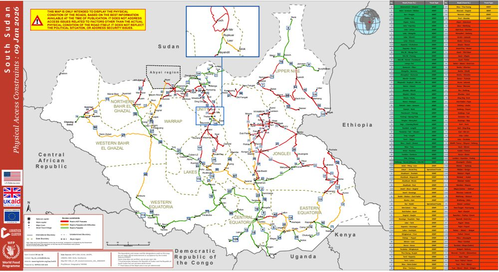<br>引用元: [Access Constraints Map, 9 January 2026, Logistics Cluster](https://logcluster.org/en/documents/maps-general-4136)<br>©︎ Logistics Cluster / WFP | 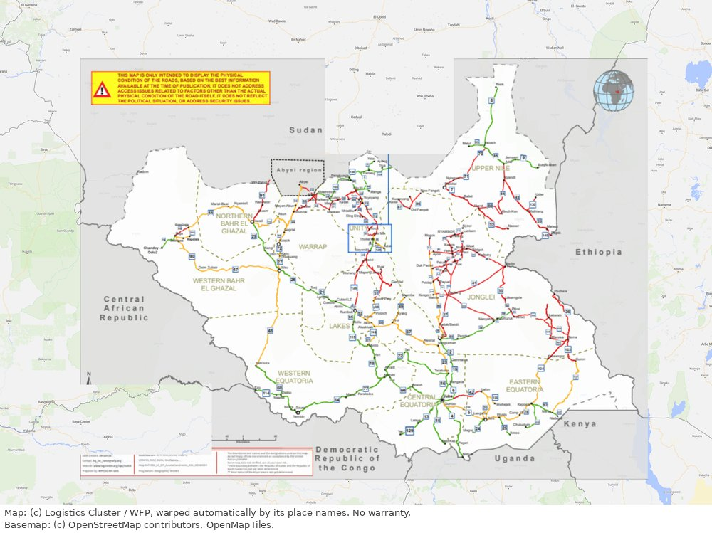 |
| 2026-07-31 | 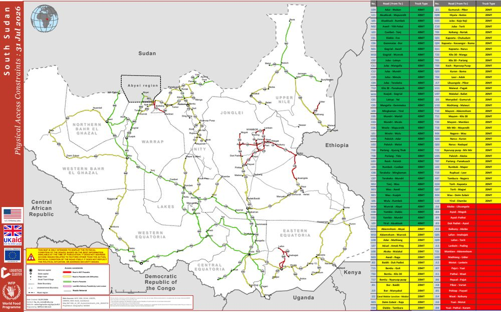<br>引用元: [Access Constraints Map, 31 July 2026, Logistics Cluster](https://logcluster.org/en/documents/south-sudan-access-constraints-map-31-july-2026)<br>©︎ Logistics Cluster / WFP | 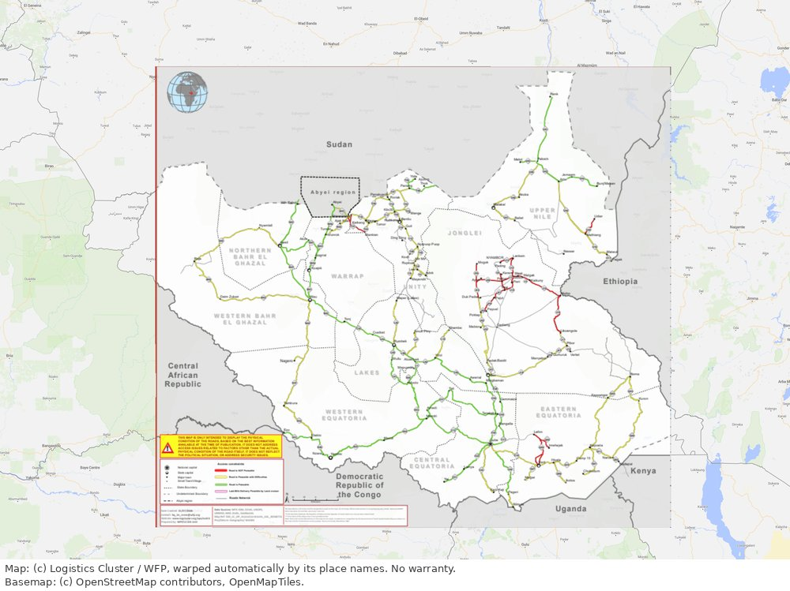 |

地図: ©︎ Logistics Cluster / WFP (引用元は表の中のページ)。背景: [© OpenStreetMap contributors](https://www.openstreetmap.org/copyright)、OpenMapTiles。

30 枚の GeoJSON を日付順に同じ地図の上に描くと、通れる道路の時系列変化になります。左上の数字は、通行状況ごとの道路の長さです。

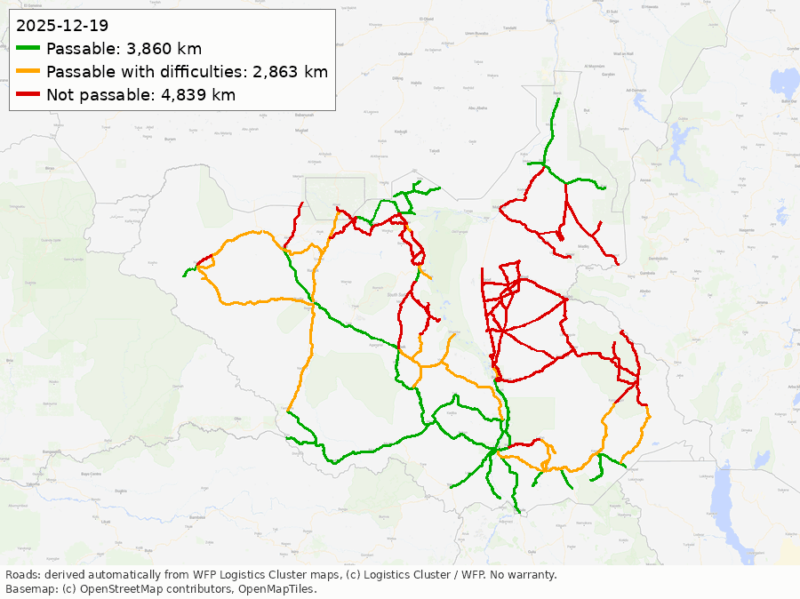

道路: ©︎ Logistics Cluster / WFP の地図から自動で取り出したもの (正確性は保証しません)。背景: [© OpenStreetMap contributors](https://www.openstreetmap.org/copyright)、OpenMapTiles。

乾季には不通の道路が多く、12 月 19 日は約 4,840 km が不通でした。4 月から 5 月には約 480〜690 km まで減り、雨季に入った 6 月から 7 月下旬には 1,360〜1,700 km に増えます。7 月 31 日から 8 月中旬は 920〜1,120 km、8 月下旬から 9 月は約 1,390 km です。ただし、道路の区切り方は 2026 年 4 月に変わっていて (3 月までの 140 本のうち、9 月の版と両端の地名が一致するのは 64 本)、描かれる道路そのものも版によって違います。元の地図が示すのは道路の物理的な状態だけで、治安や政治的な通行の可否は含みません。

地図を読むうえでつまずいた点です。

- どの版も、横長の地図を縦長の用紙に印刷し、CropBox で切り抜いています。表示の原点がページの原点と違うため、文字も線も全てずれていました。PDF を読むスキル全体で直しました。
- 地図の上に、ある地域を拡大した図が重ねて描かれています。拡大図の道路を主図の変換で写すと、スーダンやエチオピアに道路が出ます。白い背景を持つ枠を拡大図として見つけ、PDF の切り抜きで隠れているはみ出し (最大 5 pt ほど) まで含めて外しています。拡大する場所を示すだけの青い枠の中の道路は、主図の縮尺なので残します。
- 道路の色は、その色相で最も多く描かれた色を取ります。最も明るい色を選んだら、1 月の版で、凡例の外の短い純赤の線を道路の色と取り違え、不通の道路が全て消えました。
- 線と表の行の対応 (道路番号、両端の地名) は、番号の札が線の上にある 2026 年 4 月以降の版 (17 枚) にだけ付けています。3 月までの版は札が線から離れた箱にあり、色と表の食い違いが 3.7〜7.4% あるためです。

GeoJSON には、WFP の地図に基づくこと、正確性を一切保証しないこと、元の PDF の SHA-256、ツールのコミットハッシュを書いています。GeoJSON のデータそのものは、まだ公開していません。

別の作業で、自治体の浸水実績図の PDF を町丁の境界に合わせて、凡例の 1 項目の範囲を GeoJSON にした例があり、その教訓を [docs/notes/2026-11-04-pdf-map-advice.md](docs/notes/2026-11-04-pdf-map-advice.md) にまとめています。凡例の色から面を取り出す方向 (浸水域など) は、まだ作っていません。

## 結果のまとめ

模擬の課題での結果です (2026-11-04。レベル 3 の線とレベル 4 の錨は 2026-11-10)。レベル 5 の模擬の文書は [記録](docs/failures/2026-11-04-level5-documents.md)、エージェントにスキルを渡した結果は [evals/agents/results.md](evals/agents/results.md) にあります。「関門の穴」は、関門を全て通ったのに、正解から画像の半径の 1% 以上ずれた答えの数です。「対照の拒否」は、手がかりの枠を別の場所へ動かした課題を、正しく拒否した数です。

| レベル | 課題 | 正解 | 関門の穴 | 対照の拒否 |
|---|---|---:|---:|---:|
| 1 | 同じスタイル (z15、結果を見て直した課題) | 54/54 | 0 | 16/16 |
| 1 | 同じスタイル (z13 と z17、見ていない場所と種) | 32/32 | 0 | 4/4 |
| 2a | 同じスタイルの灰色と二値 | 64/72 | 0 | 6/6 |
| 2 | osm-bright | 15/24 | 0 | 6/6 |
| 2 | osm-carto | 13/24 | 0 | (同上) |
| 3 | 文字とアイコンを消した osm-liberty (見ていない場所と種) | 24/24 | 0 | 6/6 |
| 3 | e-paper-ez-sign、水も文字も無い (見ていないスタイル) | 9/16 | 0 | 2/2 |
| 3 | 鉄道だけ、川だけ (線幅 4) | 6/48 | 0 | 6/6 |
| 3 | 同上、線までの距離で測る版 (千葉、姫路、函館、見ていない場所と種) | 7/48 | 1 | 6/6 |
| 3 | 同上、縁の上限を画像の大きさに合わせた関門 (2026-11-11、関門だけ当て直した) | 4/48 | 0 | 6/6 |
| 4 | 枠もズームも渡さない osm-liberty (見ていない場所、z14〜16、最初の版) | 6/48 | 0 | (対照なし) |
| 4 | 同上、地物の形で測る版 (ダブリン、シカゴ、バンクーバー、オークランド) | 27/48 | 0 | (対照なし) |
| 4 | 同上、地物の形で測る版 (松山、高松、長崎、青森) | 19/48 | 0 | (対照なし) |
| 4 | 同上、町の名前の錨とタイルの読みを足した版 (鳥取、福井、水戸、甲府) | 36/48 | 0 | 24/24 |
| 4 | 同上 (エディンバラ、ボストン、パース、オタワ) | 44/48 | 0 | 24/24 |
| 5 | 実際の PDF: 国連の PKO の地図 (name-gcps、結果を見て直した作例) | 3/5 通過、2 は失敗を宣言 | 目視で 0 | (対照なし) |

解けなかった課題のほとんどは、道具が失敗を宣言したものです。理由と、試して採らなかった直し方は [docs/failures/](docs/failures/) に残しています。

本番の評価には、USGS と DARPA の地質図の課題 AI4CMA を取っておき、開発中は読みません ([docs/datasets.md](docs/datasets.md))。

## 仕組み

1 つの課題は、次の順に道具を通ります。

1. `tile-reference`: 手がかりの枠とズームから、座標付きの参照の地図を作る。
2. `feature-registration`: 局所の特徴 (SIFT、ASIFT、勾配) で GCP を作る。同じか近い描き方向け。
3. `cross-style-registration`: 前の段が失敗を宣言したときだけ使う。水のマスクか線のマスクで粗く合わせ、升ごとの相互情報量で GCP を作る。
4. `gcp-refinement`: 外れた GCP を、上限 (全体の 10%) 付きで除き、何を除いたかを記録する。
5. `georef-gates`: 関門。点の数と広がり、1 点ずつ抜いたときの残差、縁での誤差の大きさ、変換の形 (裏返りや折れが無いか)、手がかりの枠との整合を確かめる。

場所の分からない地図には、別に `place-hint` があります。

| スキル | 役割 |
|---|---|
| [`tile-reference`](.agents/skills/tile-reference/SKILL.md) | 経緯度の枠とズームから、座標付きの参照の画像を作る |
| [`feature-registration`](.agents/skills/feature-registration/SKILL.md) | 局所特徴 (SIFT、ASIFT、勾配の強さ) で GCP を作る |
| [`cross-style-registration`](.agents/skills/cross-style-registration/SKILL.md) | 水や線のマスクで粗く合わせ、升ごとの相互情報量で GCP を作る |
| [`gcp-refinement`](.agents/skills/gcp-refinement/SKILL.md) | 外れた GCP を上限付きで除き、記録する |
| [`georef-gates`](.agents/skills/georef-gates/SKILL.md) | 答えを返す前の関門 |
| [`place-hint`](.agents/skills/place-hint/SKILL.md) | 地名を読んで (tesseract)、自前の Nominatim で引き、場所のあたりを付ける |
| [`graticule-gcps`](.agents/skills/graticule-gcps/SKILL.md) | ベクタ PDF の枠の経緯度の目盛りや UTM の方眼から、地名によらない GCP を作る |
| [`unit-symbols`](.agents/skills/unit-symbols/SKILL.md) | 平和維持活動の部隊配置図 (ベクタ PDF) から、部隊記号の枠、ラベル、規模、兵科、位置を読む |
| [`deployment-batch`](.agents/skills/deployment-batch/SKILL.md) | 部隊配置図の PDF をディレクトリごと、新しいものから順に、関門まで通す (再開でき、1 件の失敗が全体を止めない) |
| [`deployment-geojson`](.agents/skills/deployment-geojson/SKILL.md) | ジオリファレンスした配置図から、部隊の位置の GeoJSON を作る。参照番号を除き、PDF のハッシュと道具のコミットを付け、無保証を明記する |

構成は、姉妹リポジトリ GeoAI-master-skills (`.agents/skills/<スキル>/` に手順、スクリプト、テスト) にならっています。

## 試してみる

[uv](https://docs.astral.sh/uv/) が要ります。タイルは tile.yuiseki.net から取ります。

```sh
# 課題を作る (正解は truth に分けて書く)
uvx --with numpy --with pillow --with opencv-python-headless python evals/scripts/make_task.py \
  --style osm-liberty --center 139.7528 35.6852 --zoom 15 --size 900 700 \
  --distortion projective --strength 1.0 --seed 1 --task-out tmp/t/task --truth-out tmp/t/truth
# 手がかりの枠で参照を作り、GCP を作り、外れた点を除き、関門を通す
uvx --with numpy --with pillow python .agents/skills/tile-reference/scripts/fetch_reference.py \
  --style osm-liberty --zoom 15 --bbox <hint.json の bbox> --out tmp/t/ref
uvx --with numpy --with opencv-python-headless python .agents/skills/feature-registration/scripts/register.py \
  tmp/t/task/image.png tmp/t/ref --out tmp/t/answer.json
uvx --with numpy python .agents/skills/gcp-refinement/scripts/refine_gcps.py tmp/t/answer.json --out tmp/t/refined.json
uvx --with numpy python .agents/skills/georef-gates/scripts/check_gcps.py tmp/t/refined.json --hint tmp/t/task/hint.json
# 正解と比べる
uvx --with numpy --with pyproj python evals/scripts/score_task.py tmp/t/refined.json tmp/t/truth/truth.json
```

全てのテストは `python3 run_tests.py` で流せます。GitHub Actions でも、push ごとにテストと ruff の検査を流します (`.github/workflows/test.yml`)。tesseract の無い環境では、文字読みのテストは飛ばされます。この README の図は `docs/examples/make_example.py` で描いています。

## ドキュメント

- [AGENTS.md](AGENTS.md): エージェントへの指示と、失敗からスキルを育てる手順
- [docs/curriculum.md](docs/curriculum.md): レベル 1〜5 の課題の作り方、歪み、採点、関門
- [docs/datasets.md](docs/datasets.md): 本番用に取っておく AI4CMA と、開発に使う tile.yuiseki.net
- [docs/failures/](docs/failures/): 失敗の記録と、そこから直したこと
- [docs/related-work.md](docs/related-work.md): 先行の仕事 (uncharted-ta1、DIGMAPPER など) と、そこから取り入れること

## ライセンス

コードと文書は [Apache License 2.0](LICENSE) です。

図に写っている地図: [© OpenStreetMap contributors](https://www.openstreetmap.org/copyright)。タイルは tile.yuiseki.net で描いたものです。地図のデータは、OpenStreetMap のライセンス (ODbL) に従います。
